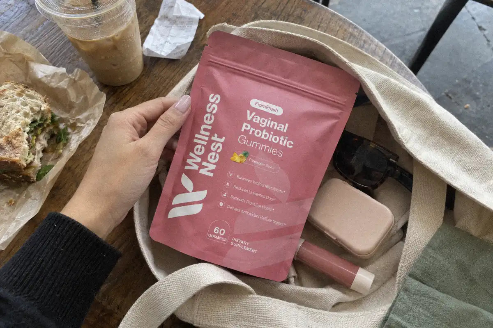
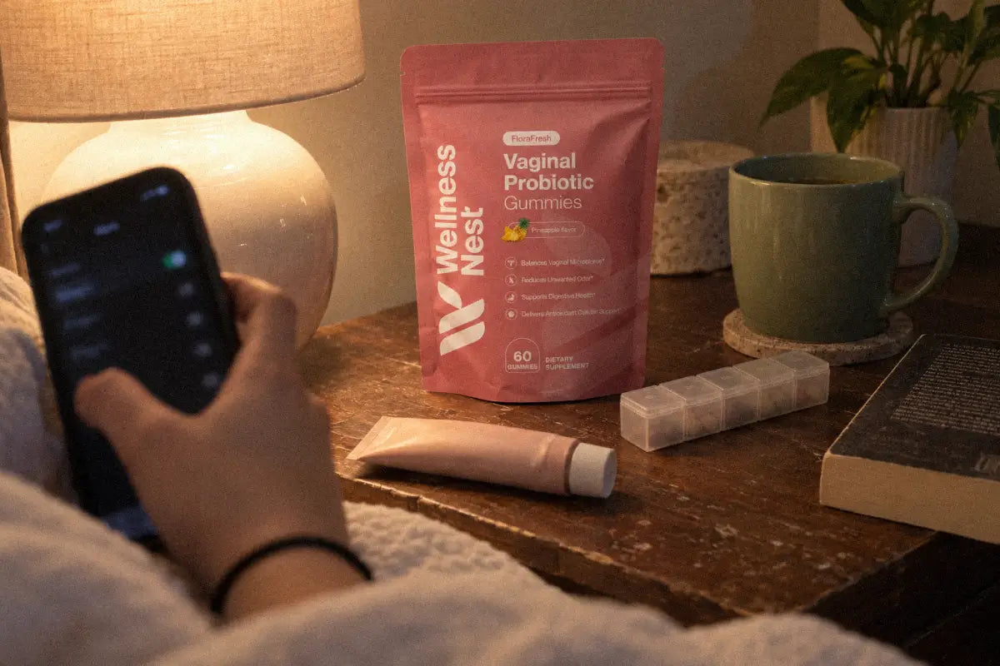
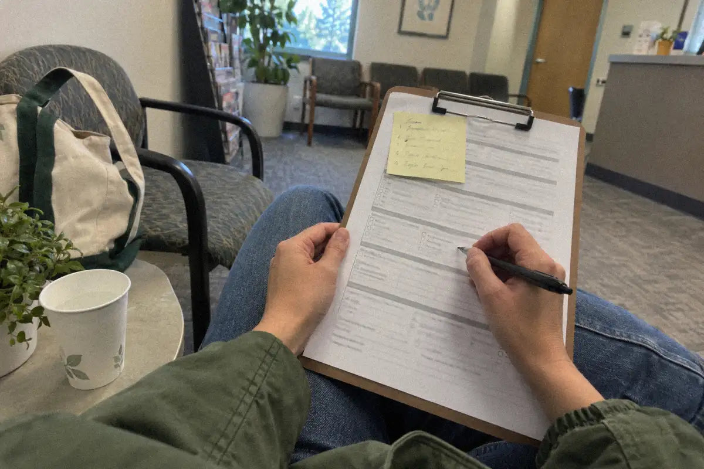
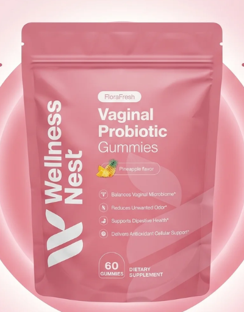

# Probiotics and Birth Control: Can You Take Both? (US 2026)
<!-- meta_description: Probiotics and birth control in the US: the Seasonale label does not list probiotics with enzyme inducers. Ask a prescriber before you combine them. -->
<!-- refresh-of: probiotics-and-birth-control-can-you-take-both-us-2026 article 634884227387. Same URL. Opening and FloraFresh formula lines updated. Do not publish. -->

In the United States, [FDA prescribing information for Seasonale](https://www.accessdata.fda.gov/drugsatfda_docs/label/2022/021544s017lbl.pdf), a combined oral contraceptive, names enzyme-inducing drugs and St. John's wort among products that may lower hormone levels. Probiotic supplements are not on that example list. That omission is not proof of no interaction with every method, so ask your prescriber or pharmacist before combining them.

This guide covers what the evidence says, where the real interaction questions are, and how birth control can change the vaginal environment. It does not repeat our guides on [probiotics after antibiotics](https://wellnessnest.co/blogs/news/probiotics-after-antibiotics-for-women-when-to-start-us) or [vaginal probiotic side effects](https://wellnessnest.co/blogs/news/vaginal-probiotics-side-effects-normal-vs-stop-us-2026). Read those for timing after a course of antibiotics and for normal versus stop-now symptoms.

## Do Probiotics Make the Pill Less Effective?

There is no evidence that they do. The US Medical Eligibility Criteria for Contraceptive Use (US MEC), the CDC's 2024 guidance for clinicians, has a drug-interaction section for combined hormonal contraceptives. It covers antiretrovirals, anticonvulsants, antimicrobials, SSRIs and St. John's wort. Probiotics are not on that list. A probiotic is live bacteria and does not contain hormones, so there is no known route for it to change hormone levels from the pill.

What can reduce pill protection is a problem with absorption. The CDC's US Selected Practice Recommendations (US SPR) say that vomiting or diarrhea for 48 hours or more can mean the pill was not absorbed. In that case, keep taking your pills and use condoms or avoid sex until you have taken hormonal pills for 7 days in a row after the illness ends. Vomiting or diarrhea for less than 48 hours needs no extra dose and no backup method, per the same CDC page.

## The Real Interaction Question: Antibiotics, Not Probiotics

For decades, people have asked whether antibiotics weaken the pill. The CDC answer is clear for most of them. In the US MEC, broad-spectrum antibiotics, antifungals and antiparasitics are all category 1 with combined hormonal contraceptives. Category 1 means there is no restriction on use.

The exception is rifampin or rifabutin. Those are category 3, and the CDC says they are "likely to reduce the effectiveness" of combined hormonal contraceptives. St. John's wort, an herbal product, is category 2. So if you start a new medicine or herb, the useful question for your pharmacist is about that item, not about your probiotic.

| Item taken with the pill, patch or ring | CDC US MEC category | What it means |
| --- | --- | --- |
| Probiotics | Not listed | No known interaction in CDC guidance |
| Broad-spectrum antibiotics | 1 | No restriction |
| Antifungals | 1 | No restriction |
| Antiparasitics | 1 | No restriction |
| St. John's wort | 2 | Advantages generally outweigh risks |
| Rifampin or rifabutin | 3 | Likely to reduce effectiveness |

Source: [CDC US MEC, combined hormonal contraceptives](https://www.cdc.gov/contraception/hcp/usmec/combined-hormonal-contraceptives.html).

## How Birth Control Can Change Vaginal pH and Flora in the US

Hormones shape the vaginal environment. A 2014 study in PLoS One explains that estrogen raises glycogen in vaginal cells. In 21 women, samples with high free glycogen had a median pH of 4.4 and were mostly Lactobacillus. Samples with low glycogen had a median pH of 5.8 and very little Lactobacillus ([Mirmonsef 2014](https://pmc.ncbi.nlm.nih.gov/articles/PMC4102502/)).

Hormonal birth control seems to lean in a helpful direction. A 2013 review of 55 studies found hormonal contraception was linked to lower odds of bacterial vaginosis (BV). The odds ratio was 0.68 for current BV, 0.82 for new BV and 0.78 for any BV. The link held for both combined and progestin-only methods ([Vodstrcil 2013](https://journals.plos.org/plosone/article?id=10.1371/journal.pone.0073055)). These were observational studies, so they show a link, not proof of cause.

✅ No CDC-listed interaction between probiotics and hormonal birth control

✅ Rifampin, rifabutin and St. John's wort are the items to ask about

✅ Vomiting or diarrhea for 48 hours or more is a backup-method moment

✅ Your prescriber has the final word on your own medicines

## Probiotics and an IUD: What Users Should Know

A probiotic does not interact with an IUD. The device works in the uterus and a gummy works through the gut, so there is nothing for them to cancel out.

The type of IUD may matter for vaginal flora, though. A 2021 study of 2,585 women in Clinical Infectious Diseases found that copper IUD users had a 1.28-fold higher rate of BV than women using no method or another non-hormonal method. In the first 6 months after starting, the rate was 1.52-fold higher than before. The rate went back to its earlier level within 1 year after the copper IUD came out ([Peebles 2021](https://doi.org/10.1093/cid/ciaa703)). Hormonal IUDs release a progestin, and the 2013 review above linked progestin-only methods to lower BV odds.

If you use a copper IUD and get BV often, talk to your clinician. A probiotic is not a treatment for BV, and it does not replace a visit.

## When to Take Probiotics With Birth Control

No spacing is needed, since there is no known interaction. Pick a routine you will keep. Many people take their pill at the same time each day, and adding a probiotic to that moment makes both easier to remember.

The Supplement Facts serving for FloraFresh is 2 gummies of Bacillus coagulans SNZ-1969, 15B CFU. If you are just starting, see our guide on [how long vaginal probiotics take to work](https://wellnessnest.co/blogs/news/vaginal-probiotics-how-long-until-they-work-us-2026) and our breakdown of [which strains have research behind them](https://wellnessnest.co/blogs/news/vaginal-probiotics-which-strains-actually-work-us-2026).

On safety, the NIH's National Center for Complementary and Integrative Health says probiotics have a long history of apparently safe use, mainly in healthy people. The risk of harm is greater in people with a severe illness or a weak immune system. It also notes that probiotics sold as dietary supplements do not need FDA approval before they are sold ([NCCIH](https://www.nccih.nih.gov/health/probiotics-what-you-need-to-know)).

[See the FloraFresh product page →](https://wellnessnest.co/products/florafresh-vaginal-probiotics-gummies)

## Signs to See a Clinician

A probiotic is a daily supplement, not a fix for symptoms. Book a visit if you notice any of these:

- A strong or fishy odor, or discharge that changes color
- Itching, burning or pain when you pee
- Pelvic pain, fever, or bleeding between periods that is new for you
- Vomiting or diarrhea for 48 hours or more while on the pill
- A new prescription, especially rifampin or rifabutin
- You are pregnant or trying to get pregnant

Bring a list of everything you take, including supplements, to that appointment. That gives your clinician what they need to check for real interactions.

## Where to Buy FloraFresh Vaginal Probiotics in the US

The official source is Wellness Nest at wellnessnest.co. [FloraFresh Vaginal Probiotic Gummies](https://wellnessnest.co/products/florafresh-vaginal-probiotics-gummies) cost $40.99. The Supplement Facts serving for FloraFresh is 2 gummies of Bacillus coagulans SNZ-1969, 15B CFU, with Vitamin C 30 mg and pineapple fruit powder 100 mg (with bromelain). They are sweetened with maltitol and isomalt, so they are not sugar-free. Label badges include allergen free, vegan, halal and gluten free.
Wellness Nest offers free US shipping on orders over $70 and a 90-day refund policy (eligibility applies). You can also browse the [women's essentials collection](https://wellnessnest.co/collections/womens-essentials-collection) or the store's [best sellers](https://wellnessnest.co/collections/best-seller).

A related page in this cluster is [Probiotics During Your Period: Keep Taking Them? (US 2026)](https://wellnessnest.co/blogs/news/probiotics-during-your-period-keep-taking-them-us-2026).

Another page that stays on this topic is [Best Time to Take Vaginal Probiotics: 6 Rules (US 2026)](https://wellnessnest.co/blogs/news/best-time-to-take-vaginal-probiotics-6-rules-us-2026).

## What to ask next

These questions link to other articles in the same cluster. They are follow-ups, not a second FAQ.

- [can i take probiotic while on my period?](https://wellnessnest.co/blogs/news/probiotics-during-your-period-keep-taking-them-us-2026)
- [how long does it take vaginal probiotics to work?](https://wellnessnest.co/blogs/news/probiotics-after-antibiotics-for-women-when-to-start-us)
- [What should you know about best time to take vaginal probiotics?](https://wellnessnest.co/blogs/news/best-time-to-take-vaginal-probiotics-6-rules-us-2026)
- [side-effects?](https://wellnessnest.co/blogs/news/vaginal-probiotics-side-effects-normal-vs-stop-us-2026)

## Frequently Asked Questions

### Can I take vaginal probiotics while on the pill?

Yes, for most people. CDC contraception guidance does not list probiotics as an interaction for the pill, patch or ring, and we found no study showing a probiotic lowers pill effectiveness. The items that do matter are rifampin, rifabutin and, to a lesser degree, St. John's wort. Long vomiting or diarrhea also matters. If you take other medicines, ask your pharmacist to review the full list.

### Do probiotics affect an IUD?

No. An IUD works inside the uterus, and a probiotic does not act on the device or on the hormone a hormonal IUD releases. One 2021 study did link copper IUDs to a higher rate of bacterial vaginosis, mostly in the first 6 months after starting. If you have copper IUD symptoms like odor or itching, see your clinician. A probiotic does not treat BV.

### Do antibiotics stop birth control from working?

Most do not. The CDC rates broad-spectrum antibiotics, antifungals and antiparasitics as category 1 with combined hormonal contraceptives, which means no restriction. Rifampin and rifabutin are the exception: the CDC rates them category 3 and says they are likely to reduce effectiveness. If an antibiotic gives you vomiting or diarrhea for 48 hours or more, use a backup method until you have 7 pill days in a row.

### What time of day should I take probiotics with birth control?

Any time that fits your routine. There is no known interaction, so you do not need to space them apart. The Supplement Facts serving for FloraFresh is 2 gummies of Bacillus coagulans SNZ-1969, 15B CFU. Many people pair the gummies with their daily pill so they remember both. If you take other supplements or medicines with timing rules, check those labels too, and ask your pharmacist if you are unsure.

### Where can I buy FloraFresh in the US?

Buy FloraFresh from the official source, Wellness Nest, at wellnessnest.co. FloraFresh is $40.99, with free US shipping on orders over $70 and a 90-day refund policy (eligibility applies). The Supplement Facts serving for FloraFresh is 2 gummies of Bacillus coagulans SNZ-1969, 15B CFU, with Vitamin C 30 mg and pineapple fruit powder 100 mg (with bromelain). They are sweetened with maltitol and isomalt, so they are not sugar-free. Label badges include allergen free, vegan, halal and gluten free. The pouch is pineapple flavor.

### About the Author

[Mike Moretti](/pages/mike-moretti) — Mike Moretti is a co-founder of Wellness Nest and the brand's public face.

This article is for education only and is not medical advice. Talk to your prescriber before you change any medicine or supplement.

These statements have not been evaluated by the Food and Drug Administration. This product is not intended to diagnose, treat, cure, or prevent any disease.
