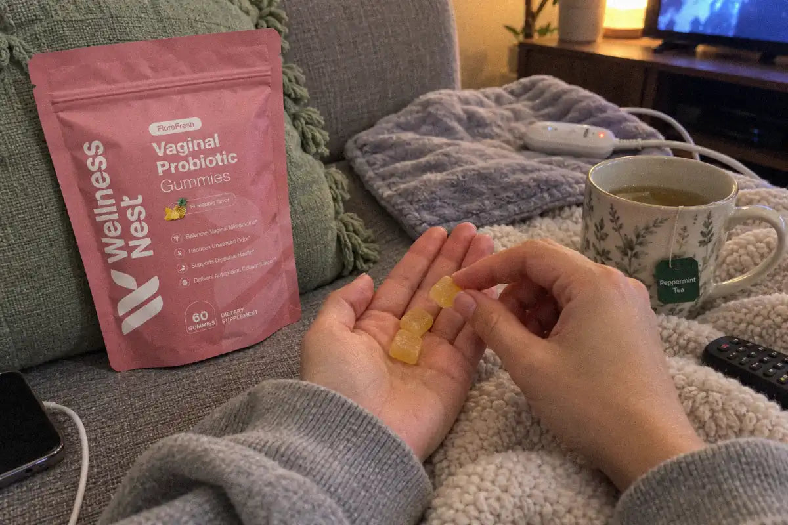
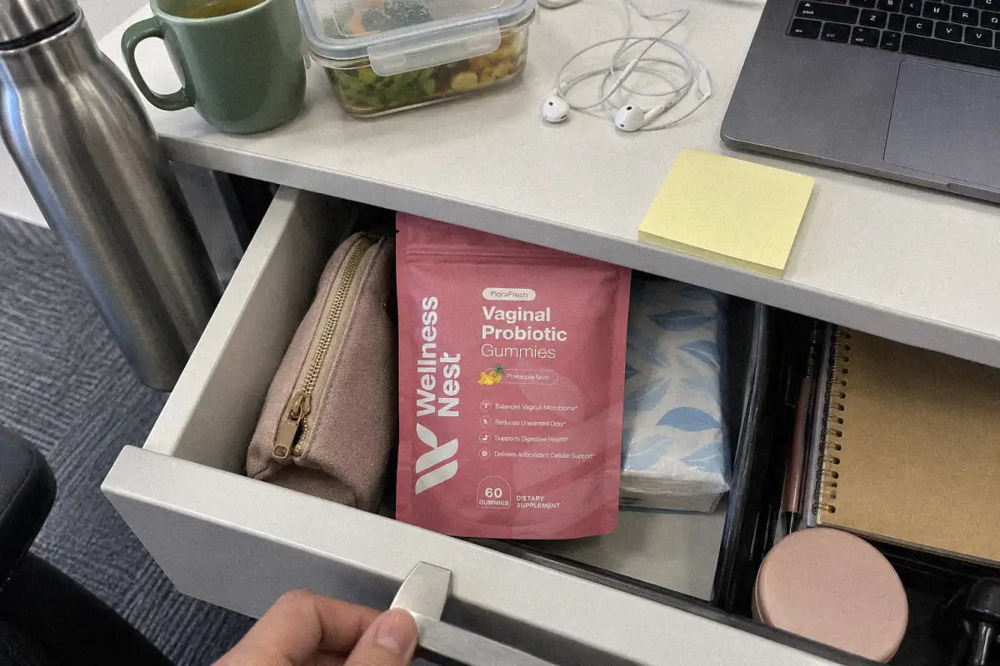
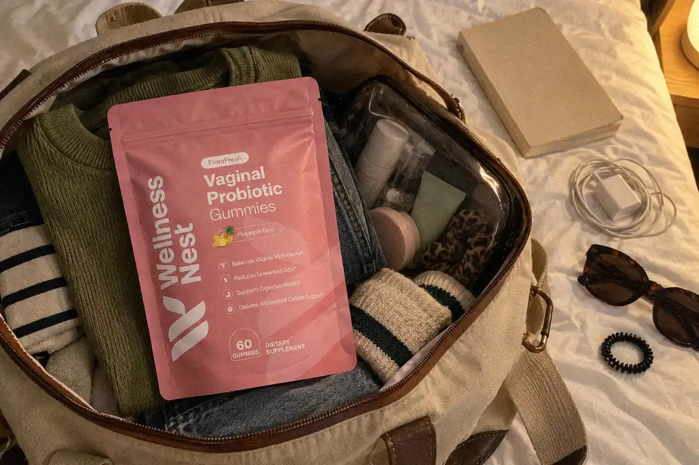

# Probiotics During Your Period: Keep Taking Them? (US 2026)
<!-- meta_description: Can you take probiotics on your period? The NIH fact sheet does not say to stop, and it does not discuss menstruation. Ask a US clinician if you are unsure. -->
<!-- refresh-of: probiotics-during-your-period-keep-taking-them-us-2026 article 634880852283. Same URL. Opening and FloraFresh formula lines updated. Do not publish. -->

In the United States, the [NIH probiotic fact sheet](https://ods.od.nih.gov/factsheets/Probiotics-HealthProfessional/) does not tell healthy adults to stop probiotics during a menstrual period. It says probiotics are unlikely to cause harm in healthy people, side effects are usually minor, such as gas, and there is no formal recommendation for or against use. The sheet does not discuss menstruation.

That is the short answer. The longer one explains what actually changes in your body during those few days, what a normal shift feels like, and which signs mean a probiotic is the wrong tool and a clinician visit is the right one.

THE MONTHLY PH SWING

## Why Your Period Changes Vaginal pH

A healthy vagina is acidic. Its normal pH sits around 3.5 to 4.5, and most of that acid is lactic acid made by Lactobacillus bacteria ([Amabebe & Anumba, 2018](https://pmc.ncbi.nlm.nih.gov/articles/PMC6008313/)). The low pH is part of what keeps unwanted microbes from taking over.

Menstrual blood works against that. It has a pH close to normal blood, about 7.2 to 7.4, so it neutralizes the acidic vaginal environment. A 2022 review describes menstrual blood as producing "a rise in vaginal pH and iron, as well as a drop in the quantity of Lactobacillus" ([Shen et al., 2022](https://pmc.ncbi.nlm.nih.gov/articles/PMC9354832/)).

The same review by Amabebe and Anumba notes that menstruation "significantly reversibly alters the vaginal microbial diversity." The key word is reversibly. For most women, the shift is temporary.

WHAT THE DAILY-SWAB STUDIES SAW

## What Happens to Vaginal Bacteria During Menstruation

Two studies tracked this day by day, which is rare in women's health research.

In the first, 26 college women aged 18 to 22 collected a vaginal swab every day for 10 weeks. During menses, microbial diversity went up and Lactobacillus went down, mostly in the first 5 days of bleeding. Lasting shifts from one bacterial pattern to another were also more likely to start during a period ([Song et al., 2020](https://pmc.ncbi.nlm.nih.gov/articles/PMC7343982/)).

In the second, 49 healthy young women swabbed daily across a full cycle. The researchers concluded that menstrual bleeding and unprotected sex both reduce the stability of the vaginal microbiome. They described a menses-related pattern: Lactobacillus dominance dipped while bleeding and came back by mid-cycle. In a small number of women, though, the change triggered during a period did not reverse ([Hugerth et al., 2024](https://pmc.ncbi.nlm.nih.gov/articles/PMC11331738/)).

| What changes during your period | What the research found | Source |
| --- | --- | --- |
| Vaginal pH | Rises, because menstrual blood is near pH 7.2–7.4 | [Shen 2022](https://pmc.ncbi.nlm.nih.gov/articles/PMC9354832/) |
| Lactobacillus levels | Drop, mostly in the first 5 days of bleeding | [Song 2020](https://pmc.ncbi.nlm.nih.gov/articles/PMC7343982/) |
| Microbial diversity | Goes up, then usually settles after the period | [Song 2020](https://pmc.ncbi.nlm.nih.gov/articles/PMC7343982/) |
| Long-term stability | Lower during menses; a few women stay shifted | [Hugerth 2024](https://pmc.ncbi.nlm.nih.gov/articles/PMC11331738/) |
| BV-range pH | BV is linked to vaginal pH above 4.5 | [Amabebe 2018](https://pmc.ncbi.nlm.nih.gov/articles/PMC6008313/) |

Read the table as a timing map. Your period is the part of the month when the protective bacteria are lowest and pH is highest. Stopping a daily probiotic at exactly that point makes little sense.

WHY YOU SHOULD NOT PAUSE

## Should You Keep Taking Probiotics on Your Period?

Yes. There are three practical reasons.

- Nothing says to stop. Oral probiotics are swallowed, so bleeding does not interfere with taking them. No US health agency advises a pause during menstruation.
- Consistency is the whole method. Probiotics build their effect over weeks of daily use, not single doses. Our guide on [how long vaginal probiotics take to work](https://wellnessnest.co/blogs/news/vaginal-probiotics-how-long-until-they-work-us-2026) covers that timeline. Skipping five days every month resets part of the routine.
- The period is the low point. The studies above show Lactobacillus at its lowest while you bleed. That is when support matters most, not least.

Be honest with yourself about the limits, too. No trial has tested oral probiotics during menses specifically. The cycle data is observational, and results differ by strain, per the [NCCIH](https://www.nccih.nih.gov/health/probiotics-usefulness-and-safety), which notes that "different types of probiotics may have different effects." A probiotic supports balance over time. It does not cancel the pH rise from menstrual blood. For a strain-by-strain look, read [which vaginal probiotic strains actually work](https://wellnessnest.co/blogs/news/vaginal-probiotics-which-strains-actually-work-us-2026).

If your period brings cramps and low energy, the easiest fix is to tie the gummy to something you already do every day, like lunch or your evening tea.

NORMAL OR NOT?

## Period Odor: What Is Normal and What Is Not

A mild smell that changes across the day is normal. The Office on Women's Health says healthy vaginas have a mild odor, and that the vagina cleans itself ([womenshealth.gov](https://www.womenshealth.gov/a-z-topics/douching)). During a period, many women also notice a slightly metallic smell from the blood itself.

What is not normal: the same source says "any strong odor or irritation usually means something is wrong." The CDC lists the main signs of bacterial vaginosis (BV) as thin white or gray discharge and a strong fish-like odor, especially after sex. Many people with BV have no symptoms at all ([CDC](https://www.cdc.gov/bacterial-vaginosis/about/index.html)). If you are unsure which infection you might have, our guide to [yeast infection vs BV](https://wellnessnest.co/blogs/news/yeast-infection-vs-bv-how-to-tell-them-apart-us-2026) explains the difference.

The worst response to period odor is douching. The CDC says douching upsets vaginal balance, and women who douche every week are 5 times more likely to get BV ([womenshealth.gov](https://www.womenshealth.gov/a-z-topics/douching)). Most doctors recommend not douching at all.

Simple period habits that help keep balance:

✅ Keep your daily probiotic going through every day of bleeding

✅ Change a tampon within 8 hours at most

✅ Wash the outside with water and skip douches and scented sprays

✅ Notice odor that is strong, fishy, or comes with gray discharge

✅ Pack the pouch when you travel so a trip does not break the routine

## When to See a Clinician Instead

A probiotic is support, not treatment. Contact your doctor or a clinic if any of these happen:

- A strong fish-like odor or thin gray discharge, which are BV signs. The CDC says "if you have symptoms, you should be checked and treated by a healthcare provider."
- Itching, burning, or irritation that does not go away after your period ends.
- You soak through a pad or tampon every 1 to 2 hours, bleed longer than 8 days, or have severe pain ([womenshealth.gov](https://www.womenshealth.gov/menstrual-cycle/your-menstrual-cycle)).
- Sudden high fever, vomiting, or a rash while using a tampon or cup. These can be signs of toxic shock syndrome. Remove the tampon or cup and call 911.

For BV-specific evidence on probiotics, read [do probiotics for BV actually work](https://wellnessnest.co/blogs/news/probiotics-for-bv-do-they-actually-work-us-2026).

## Choosing a Vaginal Probiotic in the US

In the US, probiotics are dietary supplements. They do not need FDA approval before they go on sale, and labels may only describe support for normal function ([NCCIH](https://www.nccih.nih.gov/health/probiotics-usefulness-and-safety)). Look for named strains, a CFU count, and a format you will take every single day, including period days.

Wellness Nest [FloraFresh Vaginal Probiotic Gummies](https://wellnessnest.co/products/florafresh-vaginal-probiotics-gummies) cost $40.99 for 60 gummies. The Supplement Facts serving for FloraFresh is 2 gummies of Bacillus coagulans SNZ-1969, with Vitamin C 30 mg and pineapple fruit powder 100 mg (with bromelain). They are sweetened with maltitol and isomalt, so they are not sugar-free. Label badges include allergen free, vegan, halal and gluten free. This page does not state a CFU count.

[See the FloraFresh product page →](https://wellnessnest.co/products/florafresh-vaginal-probiotics-gummies)

You can also browse the [Women's Essentials collection](https://wellnessnest.co/collections/womens-essentials-collection) or our [best sellers](https://wellnessnest.co/collections/best-seller).

The pillar page for this topic is [Probiotics and Birth Control: Can You Take Both? (US 2026)](https://wellnessnest.co/blogs/news/probiotics-and-birth-control-can-you-take-both-us-2026), which is the broader guide the rest of the cluster points back to.

A related page in this cluster is [Probiotics After Antibiotics for Women: When to Start (US)](https://wellnessnest.co/blogs/news/probiotics-after-antibiotics-for-women-when-to-start-us).

Readers who want the next specific answer can read [Best Time to Take Vaginal Probiotics: 6 Rules (US 2026)](https://wellnessnest.co/blogs/news/best-time-to-take-vaginal-probiotics-6-rules-us-2026).

Another page that stays on this topic is [Vaginal Probiotics Side Effects: Normal vs Stop (US 2026)](https://wellnessnest.co/blogs/news/vaginal-probiotics-side-effects-normal-vs-stop-us-2026).

## What to ask next

These questions link to other articles in the same cluster. They are follow-ups, not a second FAQ.

- [can you take probiotics and birth control at the same time?](https://wellnessnest.co/blogs/news/probiotics-and-birth-control-can-you-take-both-us-2026)
- [how long does it take vaginal probiotics to work?](https://wellnessnest.co/blogs/news/probiotics-after-antibiotics-for-women-when-to-start-us)
- [What should you know about best time to take vaginal probiotics?](https://wellnessnest.co/blogs/news/best-time-to-take-vaginal-probiotics-6-rules-us-2026)
- [side-effects?](https://wellnessnest.co/blogs/news/vaginal-probiotics-side-effects-normal-vs-stop-us-2026)
- [Vaginal Probiotics: How Long Until They Work?](https://wellnessnest.co/blogs/news/vaginal-probiotics-how-long-until-they-work-us-2026)

## Frequently Asked Questions

### Should I stop taking probiotics during my period?

No. Keep taking an oral probiotic every day of your cycle, including period days. Menstrual blood raises vaginal pH and Lactobacillus levels dip while you bleed, so stopping then removes support at the lowest point of the month.

### Why does my vaginal pH go up during my period?

Menstrual blood has a pH of about 7.2 to 7.4, close to normal blood, while a healthy vagina sits around 3.5 to 4.5. The blood neutralizes some of the acid, so pH rises for a few days. For most women it returns to normal after the period.

### Is it normal to smell different on my period?

A mild or slightly metallic smell is normal. A strong fish-like odor, gray discharge, or itching is not, and the CDC advises getting checked by a provider. Do not douche to cover odor, because douching raises BV risk.

### Where can I buy vaginal probiotics for period support in the US?

Wellness Nest sells FloraFresh Vaginal Probiotic Gummies online at [wellnessnest.co](https://wellnessnest.co/products/florafresh-vaginal-probiotics-gummies) for $40.99 per 60-gummy pouch, with shipping to US addresses. Check the product page at checkout for current shipping options.

FloraFresh Vaginal Probiotic Gummies

Bacillus coagulans SNZ-1969 in a pineapple gummy. The Supplement Facts serving is 2 gummies. This page does not state a CFU count.

[Shop FloraFresh →](https://wellnessnest.co/products/florafresh-vaginal-probiotics-gummies)

### About the Author

[Dr. Marcus Hale](/pages/dr-marcus-hale) — Dr. Marcus Hale is the resident health researcher behind Wellness Nest's editorial team, translating peer-reviewed sports-nutrition and longevity research into practical daily guidance for US readers.

This article is for education only and is not medical advice. Talk with a clinician before you change a medicine or a supplement.

These statements have not been evaluated by the Food and Drug Administration. This product is not intended to diagnose, treat, cure, or prevent any disease.
