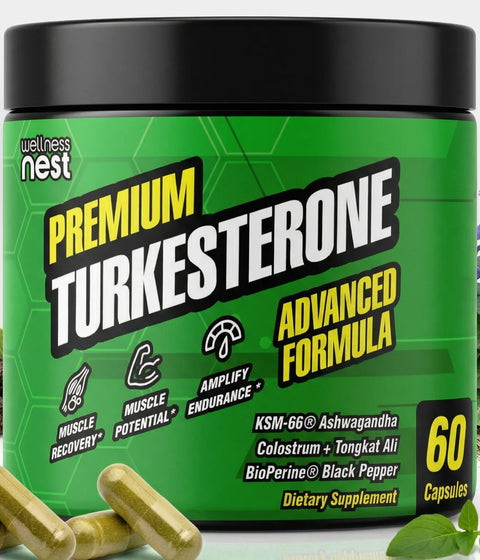
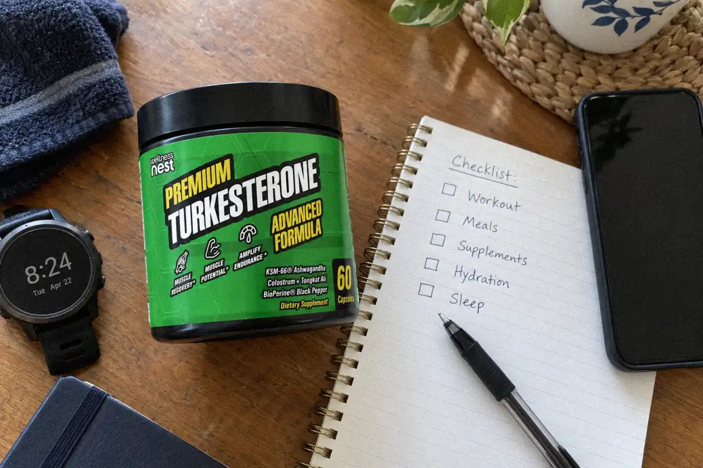
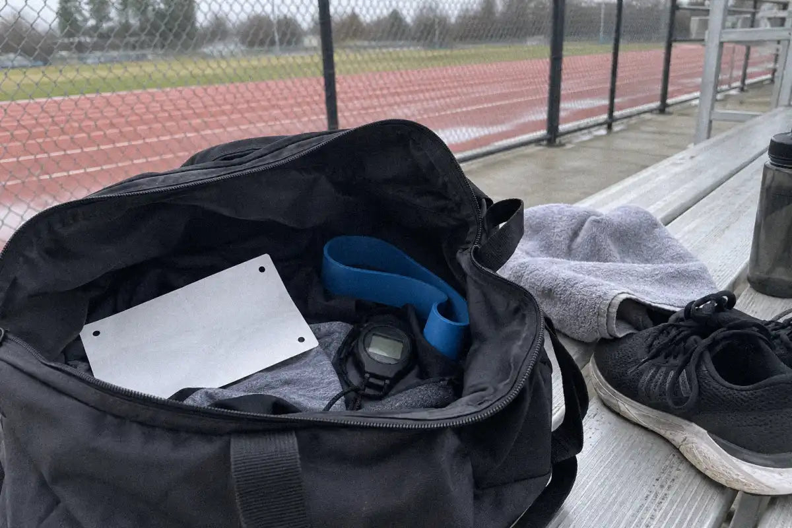
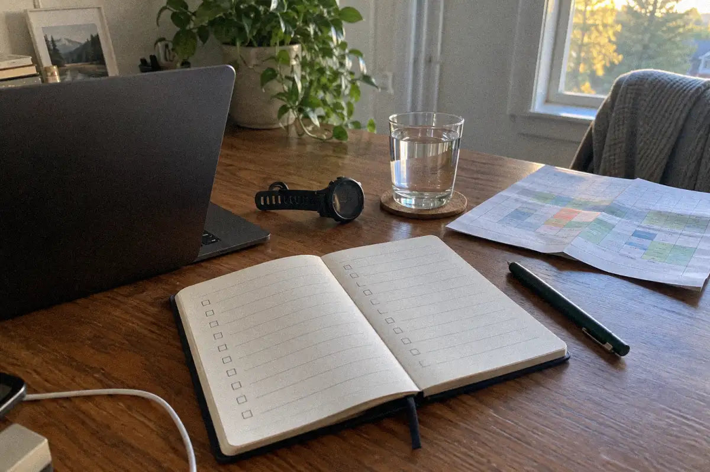

# Is Turkesterone Banned by WADA? No (US 2026)
<!-- meta_description: No. The 2026 WADA Prohibited List does not name turkesterone. Ecdysterone is monitored, not on that list. US athletes should still check the product with USADA. -->
<!-- refresh-of: turkesterone-for-athletes-drug-test-guide-us-2026 article 634907001147. Same URL. Title and meta rewritten for the WADA query. Opening answer kept. Do not publish. -->

No. The [2026 WADA Prohibited List](https://www.wada-ama.org/sites/default/files/2025-09/2026list_en_final_clean_september_2025.pdf), in force since 1 January 2026, does not name turkesterone. The [2026 Monitoring Program](https://www.wada-ama.org/sites/default/files/2025-09/2026_list_monitoring_program_en_final_clean_september_2025.pdf) names ecdysterone, not turkesterone, as a substance that is not on the Prohibited List. [USADA](https://www.usada.org/dietary-supplements/athletes-need-know-ecdysteroids/) says ecdysteroids, including turkesterone, are not currently prohibited. Tested athletes in the United States should still check the exact product with USADA.

## Is Turkesterone Banned by WADA?

USADA identifies turkesterone as an ecdysteroid and says WADA has not added ecdysteroids to its Prohibited List. USADA also says ecdysteroids were placed on the WADA Monitoring List in 2020. Monitoring is not the same as prohibition: it lets WADA collect information and consider whether a future rule change is warranted ([USADA’s ecdysteroid guidance](https://www.usada.org/dietary-supplements/athletes-need-know-ecdysteroids/)).

WADA's 2026 documents name the year. The [Prohibited List](https://www.wada-ama.org/sites/default/files/2025-09/2026list_en_final_clean_september_2025.pdf) that came into force on 1 January 2026 does not contain the word turkesterone. The [Monitoring Program](https://www.wada-ama.org/sites/default/files/2025-09/2026_list_monitoring_program_en_final_clean_september_2025.pdf) for that year places ecdysterone, not turkesterone, under anabolic agents in and out of competition, and it quotes Code Article 4.5: the program is for substances which are not on the Prohibited List. [USADA ecdysteroids page](https://www.usada.org/dietary-supplements/athletes-need-know-ecdysteroids/), retrieved 24 October 2026 with no publication date on the page, still says ecdysteroids are not currently prohibited and gives turkesterone as an example. That is ingredient status, not clearance for one jar.

That answer applies to the ingredient status described by USADA, not to every product sold as turkesterone. A supplement can contain undeclared substances, a contaminated batch, or additional ingredients with different rules. No current sport-certification claim appears on the Wellness Nest [Turkesterone Advanced Formula product page](https://wellnessnest.co/products/turkesterone-advanced-formula), so do not treat the product as certified for tested sport.

### Will turkesterone show up on a drug test?

A negative prediction is not responsible. The available USADA statement addresses WADA status, not a guarantee that every product batch will produce a negative test. Testing programs change, labels can be incomplete, and athletes remain responsible for what they ingest. Record the exact product, lot, purchase date and label, then ask the governing body or team compliance professional before use.

## What the Formula Label Means for Tested Athletes

The front label and live product page identify a blend of named ingredients, but the pack image is not a sport-certification seal. The product page lists turkesterone, KSM-66 Ashwagandha, tongkat ali, colostrum and BioPerine. The pack shows “60” and “Capsules”; it does not provide a Supplement Facts panel in the reviewed reference, so this article does not infer milligram amounts or a serving claim from the image. The pack-label read agreed on the separate lines 60 and Capsules and did not lock a milligram amount. Colostrum was not an agreed line on that read, even though the product description names it, so a tested athlete should use the jar in hand.

| Label ingredient or feature | What the fetched source supports | Athlete takeaway |
| --- | --- | --- |
| Turkesterone / ecdysteroids | USADA says ecdysteroids are not on the WADA Prohibited List and have been monitored since 2020 | Not currently prohibited by that statement; status can change |
| KSM-66 Ashwagandha | Named on the product page; this article makes no anti-doping clearance claim | Ask compliance staff to review the exact label and batch |
| Tongkat ali | Named on the product page; this article makes no anti-doping clearance claim | Do not assume an ingredient is cleared because the product is sold online |
| Colostrum | The 2026 WADA Prohibited List names IGF-1. The NCAA 2026-27 list writes "IGF-1 (colostrum; deer antler velvet)" | Treat the product as a specific review question before competition |
| BioPerine | Named on the product page; this article makes no anti-doping clearance claim | Check the exact formulation rather than relying on ingredient reputation |

A product ingredient list can tell you what the seller declares. It cannot prove that a batch is free from undeclared substances. That distinction matters more than the marketing phrase “natural.”

## Is Colostrum Allowed for Tested Athletes?

Colostrum is not a simple yes-or-no shortcut for a tested athlete. The [2026 WADA Prohibited List](https://www.wada-ama.org/sites/default/files/2025-09/2026list_en_final_clean_september_2025.pdf) names insulin-like growth factor 1 (IGF-1, mecasermin) and its analogues under peptide hormones, growth factors, related substances, and mimetics. The [NCAA 2026-27 banned substances PDF](https://ncaaorg.s3.amazonaws.com/ssi/substance/2026-27/2026-27NCAA_BannedSubstances.pdf) lists "IGF-1 (colostrum; deer antler velvet)" in that same class. The WADA list names IGF-1. It does not, in the text retrieved on 24 October 2026, say that every colostrum product contains it.

That wording does not establish that every colostrum product contains a prohibited concentration or that every use creates a positive test. It establishes a reason to escalate the ingredient for review. If you compete under NCAA rules, show the exact label to your athletics department before taking it. If you compete under another code, ask that federation’s anti-doping contact.

### What does the NCAA list actually ban?

The NCAA 2026–27 document names eight drug classes: stimulants; anabolic agents; beta blockers (banned for golf and rifle); diuretics and masking agents; narcotics; peptide hormones, growth factors, related substances and mimetics; hormone and metabolic modulators; and beta-2 agonists. It also says the list is not complete or exhaustive, and that chemically or pharmacologically related substances may be banned even when a specific name is absent.

So “turkesterone is not named” would be an incomplete NCAA answer. The correct answer is narrower: the fetched document does not name turkesterone or ecdysterone in its examples, but NCAA athletes must not use the absence of a name as clearance.

## What Certification Should a Tested Athlete Look For?

USADA recognizes NSF Certified for Sport as the program best suited for athletes to reduce supplement risk. USADA also cautions that certification does not necessarily eliminate the chance of testing positive and being sanctioned ([USADA supplement-risk guidance](https://www.usada.org/athlete-advisory/supplement-risk-nsf-certified-for-sport/)). Certification lowers risk; it does not transfer responsibility away from the athlete.

Use this checklist before buying or taking a product:

- Search the exact product and lot. A logo on a brand website is not enough; confirm the current certification database entry.
- Compare the certified label with the bottle. Name, flavor, form, lot and ingredient panel should match.
- Check every active ingredient. Do not stop at turkesterone. Review colostrum, botanicals, extracts and proprietary blends.
- Ask your sport’s authority. Team staff, a federation, NCAA compliance office or anti-doping organization may apply a different rule set.
- Keep records. Save the label, receipt, lot number, certification result and the answer you received.

The Wellness Nest product page reviewed for this article does not show an NSF Certified for Sport claim. That is not proof that the product is contaminated; it means this article cannot claim that certification.

## Where to Buy Turkesterone in the US

Wellness Nest lists [Turkesterone Advanced Formula](https://wellnessnest.co/products/turkesterone-advanced-formula) at $75 on the reviewed US product page. The product is also listed in the [Men’s Essential Collection](https://wellnessnest.co/collections/mens-essential-collection) and [Shilajit Wellness Stack](https://wellnessnest.co/collections/shilajit-wellness-stack). Check the live PDP, checkout and your sport’s compliance guidance before ordering or using any supplement.

The safest buying decision for a tested athlete is not the product with the strongest performance promise. It is the product whose exact label, certification status and batch can be documented and reviewed before use. If the product cannot answer those questions, choose a different option or wait for guidance.

For ingredient-specific background, read [turkesterone side effects and the four ingredients to check](https://wellnessnest.co/blogs/news/turkesterone-side-effects-4-ingredients-to-check-us-2026), [turkesterone vs ecdysterone](https://wellnessnest.co/blogs/news/turkesterone-vs-ecdysterone-which-is-worth-it-us-2026), and [what turkesterone benefits and dosing evidence actually shows](https://wellnessnest.co/blogs/news/turkesterone-benefits-dosing-whats-real-us-2026).

Readers who want the next specific answer can read [How Long Does Turkesterone Take to Work? (US 2026)](https://wellnessnest.co/blogs/news/how-long-does-turkesterone-take-to-work-us-2026).

Another page that stays on this topic is [Turkesterone Over 60: 5 Checks in the US](https://wellnessnest.co/blogs/news/turkesterone-over-60-5-checks-in-the-us).

For a different question in the same cluster, read [Turkesterone Cycle: Do You Need Breaks? (US 2026)](https://wellnessnest.co/blogs/news/turkesterone-cycle-do-you-need-breaks-us-2026).

## What to ask next

These questions link to other articles in the same cluster. They are follow-ups, not a second FAQ.

- [What should you know about ecdysterone vs turkesterone?](https://wellnessnest.co/blogs/news/turkesterone-vs-ecdysterone-which-is-worth-it-us-2026)
- [how long does it take for turkesterone to work?](https://wellnessnest.co/blogs/news/how-long-does-turkesterone-take-to-work-us-2026)
- [is turkesterone and tongkat ali safe?](https://wellnessnest.co/blogs/news/turkesterone-over-60-5-checks-in-the-us)
- [how to cycle turkesterone?](https://wellnessnest.co/blogs/news/turkesterone-cycle-do-you-need-breaks-us-2026)

## Frequently Asked Questions

### Is turkesterone banned by WADA?

USADA says WADA has not added ecdysteroids, including turkesterone, to the Prohibited List. USADA says they have been on the Monitoring List since 2020. Monitoring is not prohibition, but the status can change and does not certify a specific supplement batch.

### Will turkesterone show up on a drug test?

No source can guarantee a negative test for every turkesterone product. USADA’s statement addresses the ingredient’s WADA-list status, while supplements can contain undeclared or contaminated substances. Ask your sport’s compliance authority about the exact product and lot before use.

### Is colostrum allowed for tested athletes?

Do not assume it is cleared. The 2026 WADA Prohibited List names IGF-1. The NCAA 2026-27 document lists "IGF-1 (colostrum; deer antler velvet)." Have the exact label reviewed before taking a colostrum-containing product.

### What certification should a tested athlete look for?

USADA recognizes NSF Certified for Sport as the program best suited to reduce supplement risk, while warning that certification does not eliminate the possibility of a positive test or sanction. Verify the exact product and lot, then ask your sport’s compliance staff.

### Where can I buy turkesterone in the US?

Wellness Nest lists Turkesterone Advanced Formula at $75 on its US product page. The page does not show an NSF Certified for Sport claim. Review the live label, certification status and your sport’s rules before ordering or using it.

### About the Author

[Dr. Marcus Hale](/pages/dr-marcus-hale) — Dr. Marcus Hale is the resident health researcher behind Wellness Nest's editorial team, translating peer-reviewed sports-nutrition and longevity research into practical daily guidance for US readers.

This article is for education only and is not medical advice. Talk with a clinician before you change a medicine or a supplement.

This page is not an anti-doping clearance. Ask USADA or your sport's testing authority about the exact product and lot.

These statements have not been evaluated by the Food and Drug Administration. This product is not intended to diagnose, treat, cure, or prevent any disease.
