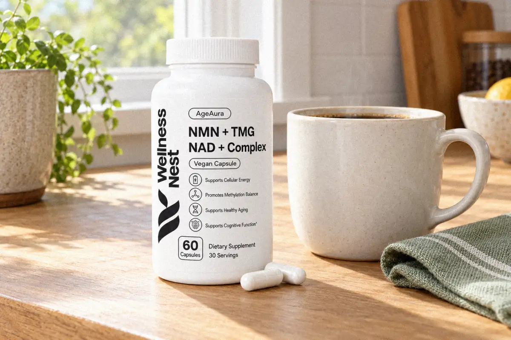
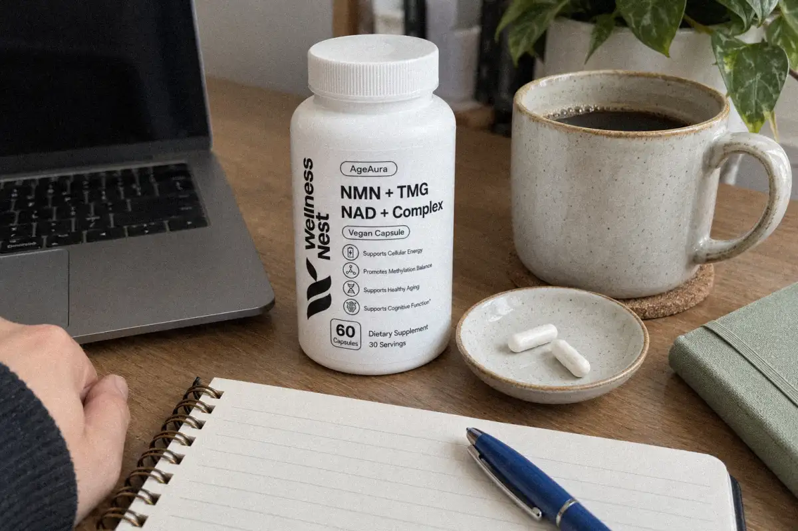
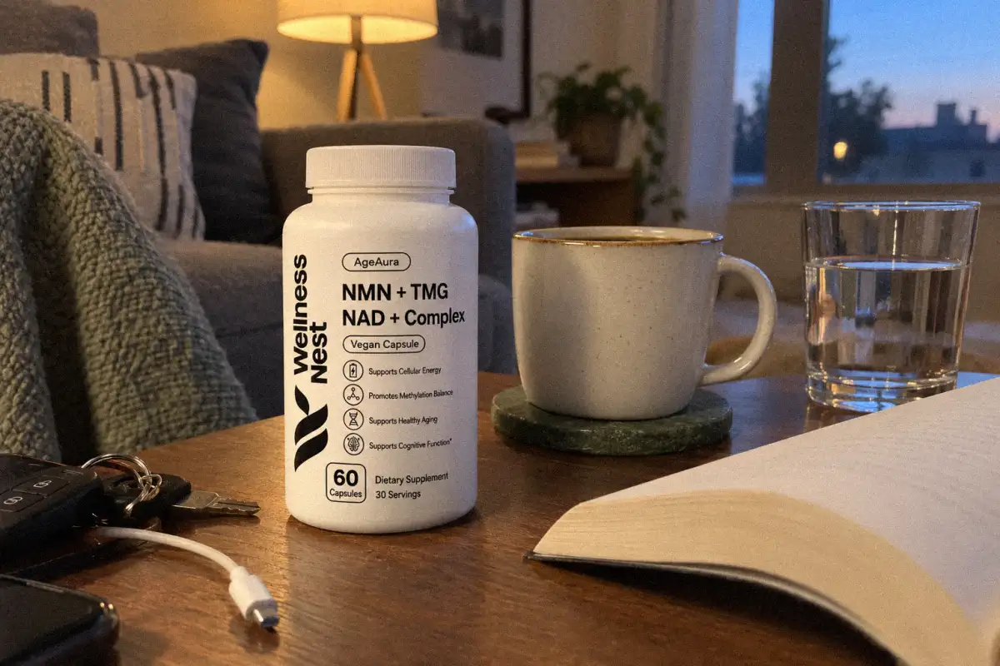
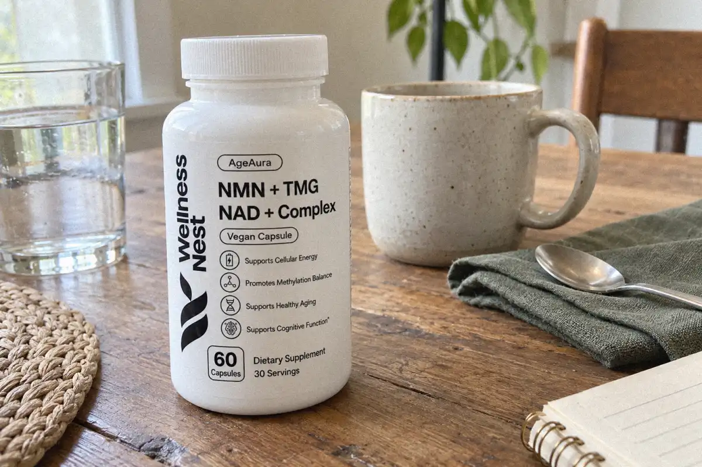

# NMN and Coffee: Can You Take Them Together? (US 2026)
<!-- meta_description: Can you take NMN with coffee? No human trial shows a conflict. Get a practical US morning routine, caffeine limits, label facts and safety checks. -->

You can take NMN with coffee because no human trial has shown that coffee cancels NMN or that you must separate them. For US adults, follow the NMN label, keep coffee within your personal tolerance, and choose a repeatable morning routine. No study has tested NMN plus coffee as a special performance or longevity combination.

The useful answer is less dramatic than the online claims. Coffee can fit beside a daily NMN habit, but it does not turn NMN into a pre-workout. If coffee causes jitters, reflux, or poor sleep, change the coffee habit rather than adding a special NMN timing rule.

## Does Coffee Cancel NMN?

No evidence shows that coffee cancels NMN. A search of the human-trial literature found no trial that compared NMN taken with coffee against NMN taken without coffee, and no trial that tested a required waiting period. That means “coffee blocks NMN” is unsupported, not proven false by a dedicated interaction study.

The closest relevant human evidence comes from a 2021 randomized, double-blind trial in recreational runners. The study used NMN with training, not coffee. Participants took split doses at breakfast and lunch or in the afternoon before training. The researchers did not compare coffee drinkers with non-coffee drinkers, so the paper cannot answer the coffee question.

The safe reading is simple: coffee is an ordinary beverage around the routine, not an ingredient proven to improve or weaken NMN’s effects.

## What Human NMN Research Actually Tested

Human NMN trials have tested dose, duration, blood NAD+ measures, physical function, or exercise outcomes. They have not established a coffee pairing. This distinction matters because a study about NMN before training is not a study about NMN with caffeine.

The 2021 runner study enrolled 48 recreational runners aged 27–50. It lasted 6 weeks and compared placebo with 300, 600, or 1,200 mg of NMN daily. Participants trained 5–6 times each week. The 600 mg and 1,200 mg groups improved some submaximal aerobic measures more than placebo, while VO2max and peak power did not change from baseline in any group. The study was small, short, and did not isolate coffee.

Other human studies measured blood NAD+ or physical-function outcomes. Those results do not prove that coffee changes NMN absorption, metabolism, or response. A claim about a coffee “boost” needs a coffee comparison that these studies did not provide.

| Question | What the fetched evidence supports | What it does not support |
|---|---|---|
| Can coffee be taken with NMN? | No human trial found here shows a required separation | A proven ideal coffee-to-NMN interval |
| Does coffee cancel NMN? | No evidence demonstrates cancellation | A definitive interaction trial |
| Is NMN a stimulant? | NMN is not established as a caffeine substitute | A guaranteed immediate energy effect |
| Did the runner trial test coffee? | It tested NMN dose plus a training plan | Coffee versus no coffee |
| What is known about caffeine safety? | FDA says most healthy adults can have about 400 mg/day | One safe limit for every person |

## Same Time as Coffee or Wait?

Either routine is reasonable when the label allows it. Take NMN with your coffee, take it before coffee, or take it after breakfast. No human trial shows that waiting 30, 60, or 120 minutes improves NMN. Pick the schedule you can repeat without upsetting your stomach or sleep.

AgeAura’s live product page says to follow the label and take 2 capsules daily at the same time each morning. It also describes taking the serving with a first meal or black coffee. The product costs $69.95 on the live US product page. Those are label and store facts, not proof that coffee improves the formula.

If coffee on an empty stomach makes you feel unwell, take your routine with food or move coffee later. If NMN itself causes an unwanted symptom, stop and ask a clinician rather than masking it with a timing experiment.

## Black Coffee, Milk, or Decaf?

Black coffee and coffee with milk are both ordinary ways to drink coffee. No human NMN trial establishes that milk blocks NMN or that black coffee is superior. Choose the version that fits your diet and digestion. Keep added sugar and total caffeine in view if those matter to your health goals.

Decaf avoids most caffeine, but it does not create a proven NMN advantage. It can be useful if regular coffee affects sleep, anxiety, reflux, or heart rate. The label for the NMN product remains the controlling instruction for the supplement; the coffee choice remains a personal beverage choice.

Coffee strength varies widely. A large café drink, cold brew, energy drink, tea, and pre-workout can all add caffeine to the same day. Track the total instead of assuming that one “cup” always contains the same amount.

## How Much Caffeine Is Too Much in the US?

The [FDA says](https://www.fda.gov/consumers/consumer-updates/spilling-beans-how-much-caffeine-too-much) that about 400 mg of caffeine a day is an amount not generally associated with dangerous negative effects for most healthy adults. The FDA also says individual sensitivity varies with body weight, medications, medical conditions, and personal response. Treat 400 mg as general guidance, not a target or guarantee.

Too much caffeine can cause symptoms such as a fast heartbeat, insomnia, anxiety, nausea, or headache. If coffee disrupts sleep, taking NMN with coffee may still be a bad morning routine for you because the problem is the caffeine response, not a demonstrated NMN conflict.

Pregnant people, people trying to conceive, and people who are breastfeeding should ask their healthcare provider whether they need to limit caffeine. Ask a clinician before combining a supplement with medication or managing a medical condition. Do not use an NMN article to replace individualized advice.

✅ &nbsp;Follow the NMN label and use the same morning routine each day.

✅ &nbsp;Take coffee with NMN or separately; no human trial proves a required interval.

✅ &nbsp;Count caffeine from coffee, tea, energy drinks, and pre-workout together.

✅ &nbsp;Ask a healthcare professional if caffeine causes symptoms or you take medication.

## Does Caffeine Affect NAD+?

Caffeine and NAD+ are often discussed together online, but a mechanism claim is not an NMN-and-coffee outcome. The fetched human evidence for this article does not show that ordinary coffee changes the effect of an NMN supplement. The practical claim should stay narrow: no human trial establishes a special coffee pairing or a required separation.

The runner study gives a useful boundary. It shows that researchers can test NMN alongside a structured training plan, but it does not show that caffeine caused the observed results. Do not turn an NMN-plus-exercise study into proof for coffee, caffeine, or a morning energy promise.

If your goal is a daily NMN habit, consistency and tolerability are better decision rules than a speculative NAD+ stack. If your goal is alertness, coffee may help you feel alert because it contains caffeine; that is a different question from whether NMN works better with it.

## What About Coffee With Milk?

There is no fetched human trial showing that milk changes NMN’s effect. A splash of milk is therefore a preference and tolerance choice, not a required part of the routine. Choose unsweetened or sweetened coffee according to your dietary needs, and count the calories or sugar if those are relevant to you.

People with food allergies or dietary restrictions should read the supplement label and the coffee additions separately. AgeAura’s live product page states that its formula contains wheat from wheat-germ-derived spermidine and is free from gluten, soy, dairy, fish, and shellfish. “Dairy-free” for the capsule does not make a milk-based coffee dairy-free.

## What If Coffee Makes You Jittery?

Reduce total caffeine, switch to decaf, drink coffee with food, or move coffee earlier. Do not increase or split the NMN dose to compensate. Jitters, racing heartbeat, anxiety, nausea, or sleep trouble are reasons to review the caffeine habit and ask a healthcare professional when symptoms persist.

The FDA notes that caffeine sensitivity differs between people. Medication use, health conditions, body weight, and personal response can change what feels tolerable. A supplement routine that looks reasonable on paper still needs to fit the person taking it.

## Where to Buy AgeAura NMN + TMG in the US

Wellness Nest is the official US source for [AgeAura Pure NMN + TMG NAD+ Complex](https://wellnessnest.co/products/ageaura-pure-nmn-tmg-nad-complex). The live product page lists the price as $69.95. It says the daily serving is 2 capsules and lists 500 mg NMN, 250 mg TMG, 100 mg trans-resveratrol, 150 mg quercetin, 50 mg apigenin, 1 mg spermidine from wheat germ extract, and 400 mcg DFE L-5-MTHF. The label says 60 capsules and 30 servings.

For related reading, see [when to take NMN in the morning or at night](https://wellnessnest.co/blogs/news/when-to-take-nmn-morning-or-night-us-2026), [how much NMN per day](https://wellnessnest.co/blogs/news/how-much-nmn-per-day-what-trials-used-us-2026), and [NMN side effects](https://wellnessnest.co/blogs/news/nmn-side-effects-6-checks-before-you-start-us-2026). You can also browse the [Wellness Nest best sellers collection](https://wellnessnest.co/collections/best-seller) or the [Wellness Nest women's essentials collection](https://wellnessnest.co/collections/womens-essentials-collection) for other store categories.

<a href="https://wellnessnest.co/products/ageaura-pure-nmn-tmg-nad-complex" style="display:inline-block;background:#54b94a;color:#ffffff;font-weight:700;padding:14px 34px;border-radius:999px;text-decoration:none;">See AgeAura NMN + TMG →</a>

## Frequently Asked Questions

### Can I take NMN with coffee?

Yes. No human trial shows that coffee cancels NMN or requires a waiting period. Follow the product label and use the routine you can repeat. If coffee causes stomach upset, anxiety, a fast heartbeat, or poor sleep, reduce caffeine or move it later and ask a healthcare professional if symptoms continue.

### Should I take NMN before or after coffee?

No human trial establishes a best order. You can take the NMN serving with coffee, before it, or after breakfast if the label permits. AgeAura’s live page directs users to take 2 capsules daily at the same time each morning and describes use with a first meal or black coffee. Keep the timing consistent instead of chasing an untested interval.

### Does coffee cancel NMN?

There is no evidence from a human coffee-interaction trial that coffee cancels NMN. The available runner trial tested NMN with exercise, not coffee versus no coffee. Do not claim that coffee improves or blocks NMN without a direct study.

### Is decaf better with NMN?

Decaf is not proven better for NMN. It is a practical choice if caffeine affects your sleep, anxiety, reflux, or heart rate. The NMN and coffee questions are separate: decaf changes caffeine exposure, but no human trial shows that it changes NMN’s effect.

### Can I take NMN with coffee and milk?

No fetched human trial shows that milk blocks NMN. Coffee with milk is a preference and tolerance choice. Check both the supplement label and the milk or creamer label for allergies and dietary needs. AgeAura’s product page says the capsule formula contains wheat from wheat germ extract and is free from dairy; that does not make a milk-based drink dairy-free.

### How much caffeine can I have with NMN in the US?

The FDA says about 400 mg of caffeine per day is generally not associated with dangerous negative effects for most healthy adults. Sensitivity varies. Count caffeine from every source, not only coffee. Pregnant people, people trying to conceive, and people who are breastfeeding should ask their healthcare provider about an appropriate limit.

### Where can I buy NMN + TMG in the US?

Wellness Nest lists AgeAura Pure NMN + TMG NAD+ Complex at $69.95 on its live US product page. The label lists 60 capsules and 30 servings. Use the [product page](https://wellnessnest.co/products/ageaura-pure-nmn-tmg-nad-complex) for current availability and store terms.

### About the Author

[Dr. Marcus Hale](/pages/dr-marcus-hale) — Dr. Marcus Hale is the resident health researcher behind Wellness Nest's editorial team, translating peer-reviewed sports-nutrition and longevity research into practical daily guidance for US readers.
