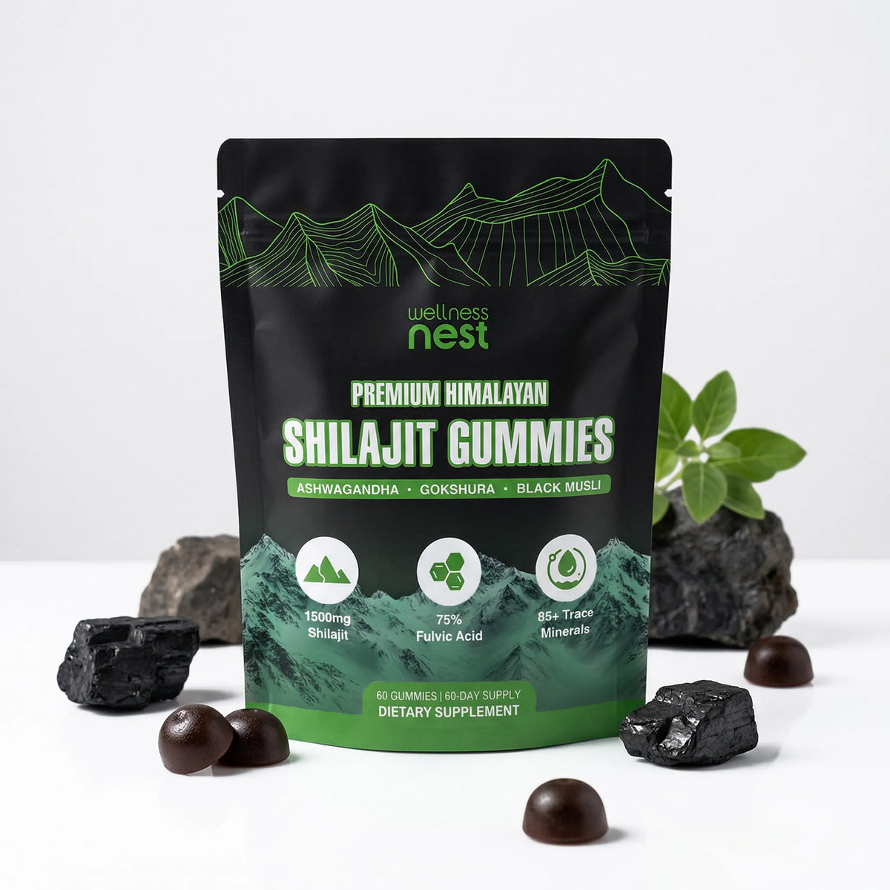
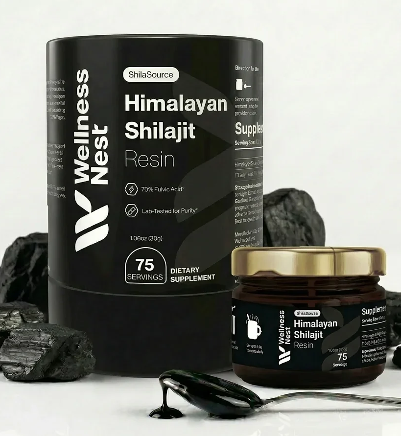

# What is Shilajit? History, Chemical Properties & Processing
<!-- meta_description: For US readers, this page describes shilajit as about 60-80% humus, plus humic and fulvic acids, plant alkaloids, resins, and waxes, not one chemical. -->
<!-- refresh-draft: 2026-10-24. Not published. Title unchanged. CLIMB draft only. -->

Shilajit, for readers in the United States, is a humic substance this page describes as about 60-80% humus. The remaining portion is humic and fulvic acids plus plant alkaloids, organic acids, resins, and waxes, rather than a single isolated chemical.

## What is shilajit made of?

Shilajit, for a reader in the United States, is not one isolated chemical on this page. The page describes it as a humic substance, about 60-80% humus, with the rest made of humic and fulvic acids, plant alkaloids, organic acids, resins, and waxes. That description is the page's own account of the substance. It is not a Wellness Nest pack-label assay.

The US Food and Drug Administration explains its role with dietary supplements on the [FDA dietary supplements overview](https://www.fda.gov/food/dietary-supplements). That page does not state what shilajit is made of.

## How do shilajit gummies compare with resin for a United States shopper?

Premium Himalayan Shilajit Gummies and ShilaSource Himalayan Shilajit Resin are separate products. The ShilaSource name covers the resin, not the gummies. One unit of either product is $69.99 one-time. Automatic Refill is $49.99 every 30 days, $44.99 every 60 days, or $39.99 every 90 days.

<table>
<thead>
<tr>
<th>Comparison</th>
<th>Premium Himalayan Shilajit Gummies</th>
<th>ShilaSource Himalayan Shilajit Resin</th>
</tr>
</thead>
<tbody>
<tr>
<td>What the name covers</td>
<td>A Wellness Nest gummies pouch. The ShilaSource name does not cover this product.</td>
<td>The resin jar. This is the product the ShilaSource name covers.</td>
</tr>
<tr>
<td>Format</td>
<td>Gummies</td>
<td>Resin</td>
</tr>
<tr>
<td>One unit, one-time</td>
<td>$69.99</td>
<td>$69.99</td>
</tr>
<tr>
<td>Automatic Refill, every 30 days</td>
<td>$49.99</td>
<td>$49.99</td>
</tr>
<tr>
<td>Automatic Refill, every 60 days</td>
<td>$44.99</td>
<td>$44.99</td>
</tr>
<tr>
<td>Automatic Refill, every 90 days</td>
<td>$39.99</td>
<td>$39.99</td>
</tr>
</tbody>
</table>

Both products are listed in the [Wellness Nest shilajit collection](https://wellnessnest.co/collections/shilajit-wellness-stack) and in the [Wellness Nest best-seller collection](https://wellnessnest.co/collections/best-seller). Shop [Premium Himalayan Shilajit Gummies](https://wellnessnest.co/products/premium-himalayan-shilajit-gummies) or [ShilaSource Himalayan Shilajit Resin](https://wellnessnest.co/products/shilasource-himalayan-shilajit-resin). The written buyer count is on [Wellness Nest shilajit reviews: what 85 buyers report](https://wellnessnest.co/blogs/news/wellness-nest-shilajit-reviews-what-85-buyers-report).

Wellness Nest processes orders within 2 business days. After the carrier picks up the package, the [shipping policy](https://wellnessnest.co/policies/shipping-policy) lists United States economy shipping at 3-7 business days, standard delivery at 2-5 business days, and priority delivery at 2 business days. The [refund policy](https://wellnessnest.co/policies/refund-policy) states a 90-day money-back guarantee on a first order, with eligibility limits, and it does not refund shipping fees.

Shilajit is a rejuvenating age-old natural substance that has stood the test of time amongst many Eastern cultures. Today we know it worldwide as one of nature's most potent nutritional supplements for enhanced energy and vitality.

Due to cryptic references and its complex nature, many are left feeling confused as to what Shilajit is exactly. In an effort to do away with some of the mystery and build an accurate picture of what it is, the below article endeavors to explain it's history, properties, where it originated from, how it's formed as well as how it works.

<h2 data-mce-fragment="1" class="heading-2 ace-line old-record-id-Oaohd3vzRoOq4SxhVMiuNp5OsBg">Shilajit's European History and Ayurvedic Origins</h2>

With firm origins in the East, the ancient Indians and other cultures revered it as a powerful medicine, with recorded history making detailed mention of this potent substance for more than 3000 years!

Found in the caves and crevices of very high mountain slopes (10 000-16 000 ft) throughout India, China, Central Asia, Iran and a few other Arabian countries; the indigenous people of these areas are all very well acquainted with Shilajit. Other names for this substance include Shilajeet, Silaras, or Shilajatu.

<h3 data-mce-fragment="1" class="heading-3 ace-line old-record-id-NfRPdtjzIoDWYpx4APBukuAJsJe">Shilajit in Ancient Ayurveda</h3>

Some of the oldest records of this medicine stem back approximately 5000 years to India and the Himalayan Mountains, which has led many to believe that this is where Shilajit originates from. Still today, the best quality Shilajit comes from the Himalayan mountains and the Altai mountains, both of which are speculated to be between 300 and 500 million years old!

Ancient Hindu and Vedic texts - such as the <em data-mce-fragment="1">Charaka Samhita and Sushrut Samhita</em> that later formed the basis of Ayurveda - explicitly outline how to prepare Shilajit, what herbs to mix it with and when it is appropriate to administer it to treat a whole host of diseases. Some of these texts even make divine, spiritual and mythological reference to Shilajit, stating that it came from the Hindu god Shiva.

<h3 data-mce-fragment="1" class="heading-3 ace-line old-record-id-Eu7BdNrFyozWlkxMVSTu6ST1sNb">Moomijo and the Widespread Eastern Origins of Shilajit</h3>

There is another substance nearly identical to Shilajit that was discovered by the folk people living in the Altai Mountains and other Eurasian ranges such as the Caucasus Mountains.

This type of Shilajit is known as Mumijo, Mumiyo, Mumie, momio, myemu or mummy. The name is a variation of the Greek word mumie, which means "to save or preserve the body".

There is very little difference between Mumiyo and Shilajit, aside from the fact that the chemical composition differs slightly and that Himalayan Shilajit is seen to be older, rarer and slightly more potent. Many people use the word Shilajit and Mumijo interchangeably, as their properties are virtually identical.

Mumiyo has been venerated countless times in Russian, Turkish, Sumerian, Egyptian, Persian and Arabic texts too.

In one such text titled <em data-mce-fragment="1">'The Form of Climates' (Mahzanul-Adwiya)</em> by Alhakim Alyavi, a story is described in which Mumijo was discovered in a mountainous cave by the Sultan's guard. He placed a sentry outside the cave to guard it like treasure and once a year, his servants would collect it.

Moreover, famous doctors, scientists and philosophers knew about Shilajit; such as Avicenna, Paracleus and Buruni, who have had a large impact on shaping ideas within society today.

As in Ayurvedic literature, all of these ancient professionals dictated in their writings how to purify and use Shilajit in combination with other herbs with the intent of better wellness.

Amongst those who knew, Mumiyo and all related substances were regarded as the closest thing to the legendary Fountain of Youth.

<h3 data-mce-fragment="1" class="heading-3 ace-line old-record-id-Mr1bdBePCoXfqOxZv6PuDsuGskb">The Movement of Shilajit From East to West</h3>

As trade opened up between the East and the West, Shilajit and Mumijo began to spread to Europe. Kings, emperors and sultans all valued the substance highly and so it was largely only accessible to the wealthy who could afford to pay for its weight in gold. Naturally it became a highly prized tradable good.

In the West, Mumie was first described by the great Greek philosopher Aristotle, around 2500 years ago. His writings also speak of it as embodying healing properties as well as how to check for the best quality.

This indicates that Shilajit has been in circulation between the East and the West for an exceptionally long time.

Other European mentions of Shilajit are surprisingly embedded in the famous works of William Shakespeare, including <em data-mce-fragment="1">The Merry Wives of Windsor, Macbeth and Othello</em>.

"I had been drowned, but that the shore was shelvy and shallow - a death that I abhor, for the water swells a man, and what a thing should I have been when I had been swelled! (By the Lord,) I should have been a <strong data-mce-fragment="1">mountain of mummy</strong>.

<em data-mce-fragment="1">The Merry Wives of Windsor, Act 3, Scene 5, Lines 13-18."</em>

"Double, double toil and trouble; Fire burn and cauldron bubble. Scale of dragon, tooth of wolf, <strong data-mce-fragment="1">Witches' mummy</strong>, maw and gulf Of the ravin'd salt-sea shark.

<em data-mce-fragment="1">Macbeth, Act 4, Scene 1, Lines 20-24."</em>

"And it was dyed in <strong data-mce-fragment="1">mummy</strong> which the skillful Conserved of maidens hearts.

<em data-mce-fragment="1">Othello, Act 3, Scene 4, Lines 65-66."</em>

<em data-mce-fragment="1">William Shakespeare</em>

<h3 data-mce-fragment="1" class="heading-3 ace-line old-record-id-WLr8dj5wHoxpq8xATIJuLRsMs1e">Shilajit in More Modern Times</h3>

In spite of all these well documented accounts of Mumijo, many falsely attribute it's discovery in modern times to the British explorer, Sir Martin Edward Stanley in the year 1870.

He observed that monkeys in the Himalayan mountains appeared to remain agile in their old age, unlike their counterparts from Europe. These monkeys were seen eating black tar-like rocks and upon further investigation, the indigenous people there confirmed that it was Shilajit which was responsible for their wellness.

At the time of this fresh rediscovery, modern science as we know it was only just beginning to take shape, resulting in a sort of renaissance for Shilajit.

Scientists from all over Eurasia began to study this seemingly magical substance, coming up with many theories as to how it came to be, as well as researching all the amazing benefits that were already common knowledge to the folk people of these regions (more on that below).

As more people started looking into it, they discovered that most high mountain peaks in the world offer a variation of this substance, including those in Norway, Africa, and South America. Today, some of the best data on the subject can be found within Russian and Indian literature.

<h2 data-mce-fragment="1" class="heading-2 ace-line old-record-id-YLaFddgR1orgV4xKx3buvpA0s7g">Physical and Chemical Properties of Shilajit</h2>

To help one better understand precisely what Mumiyo is, it's important to note both its chemical and physical properties.

These characteristics are what set it apart from other substances that look similar but are not at all the same, such as ozokerite. One ought to be careful not to confuse Shilajit for these imposter products as sometimes they are sold as fakes, yet they will not contribute positively to your overall wellbeing!

<h3 data-mce-fragment="1" class="heading-3 ace-line old-record-id-FH1GdY8OxoFFpmxQY6mu5EmasTd">Physical Appearance</h3>

When collected, Shilajit or Mumijo look like a dark brown (almost black) resinous mass. Depending on where the Shilajit is collected from, it may look slightly lighter or darker in color, as well as being tinged with shades of amber or red.

Raw unpurified himalayan shilajit, Gold Grade

According to some researchers, the more fossilized a sample is, the darker the color, which further adds to the understanding that Himalayan Shilajit is slightly older than Mumijo.

Some Mumijo may even look yellow in color, which possibly indicates that it is in its primary powdered form, completely untouched by water. However, this form is exceedingly rare to come across as it is very difficult to find.

Most Shilajit is found in it's secondary form as a waxy, resinous exudate from mountain crevices, after it has come into contact with moisture. <strong data-mce-fragment="1">Thus, this yellow type is likely to be a vastly different product</strong>, one made from fossilized animal droppings; which is occasionally referred to as mumie, but is better distinguished as Karpura Shilajit or Brakshun.

<h3 data-mce-fragment="1" class="heading-3 ace-line old-record-id-LvNhd0eDOoyMxgxHZ6PuQQrLszk">Composition &amp; List of Trace Elements</h3>

Quality Mumies are formed in some of the world's oldest mountain ranges from organic matter at incredibly high altitudes, due to natural processes over millions of years.

As a result, some refer to Mumijo and Shilajit as mineral pitch, asphaltum, ozokerite or even as some kind of petroleum-based product such as mineral oil, but in reality it is none of these.

The main difference is that Shilajit is made from organic carbon and contains an impressive list of elements that are organic in origin,as opposed to being entirely composed of inorganic materials, as seen in the above mentioned substances.

Shilajit is very similar to other humic substances found in the soil as it is comprised of about 60-80% humus - however, after millions of years and under precise conditions as found at high altitudes, these substances undergo a profound change, becoming the phenomenal natural product ready for human consumption that we know of today.

The other portion of Shilajit that is not made of humic and fulvic acids consists of beneficial plant alkaloids, organic acids, resins, waxes and many other natural compounds with uplifting effects.

<h4 data-mce-fragment="1" class="heading-4 ace-line old-record-id-NiCVd4X62oPM6Mx8zfBuMx1hs7a">Here is a complete list of trace elements in typical Shilajit:</h4>
<ul>
<li>Albumen</li>
<li>Alumina</li>
<li>organic acids (cysteine, lysine, alanine, histidine, arginine, aspartic acid, glycine, glutamic acid, serine, tyronine, threonine, proline, tyrosine, methionine, leucine, valine)</li>
<li>Barium</li>
<li>Benzoic and fatty acids</li>
<li>Beryllium</li>
<li>Bismuth</li>
<li>Calcium</li>
<li>Carbon-60</li>
<li>Chromium</li>
<li>Cobalt</li>
<li>Copper</li>
<li>Gallium</li>
<li>Gold</li>
<li>Hippuric acid</li>
<li>Humic and fulvic acids</li>
<li>Hydro-oxidized primary and secondary amide peptide bonds</li>
<li>Iron</li>
<li>Lead</li>
<li>Magnesium</li>
<li>Manganese</li>
<li>Molybdenum</li>
<li>Nickel</li>
<li>Phenolic steroids and pregnane steroids</li>
<li>Phospholipids</li>
<li>Phosphoric anhydride</li>
<li>Potassium</li>
<li>Resins and plant remains</li>
<li>Silicate groups of silicon dioxide</li>
<li>Silver</li>
<li>Small amounts of strontium oxide</li>
<li>Sodium</li>
<li>Sulfur</li>
<li>Tin</li>
<li>Titanium</li>
<li>Vanadium</li>
<li>Wax</li>
<li>Zinc</li>
</ul>
<ul data-mce-fragment="1" start="1" class="list-bullet1"></ul>

This list of elements remains more or less the same across all types of Shilajit and Mumiyo, with slight differences in the ratios of each depending on the geographical origin.

Mumijo harvested from the Caucasus Mountains, for instance, tends to be higher in iron, copper and manganese than that of Central Asian varieties.

In the Himalayas, four types of Shilajit have been taken into account based on their ratio of nutrients: red (gold), blue (copper), white (silver) and black (iron). The colors are referring to the color of the ores the Shilajit is found in and around, with there being fractionally more of that specific mineral in the Shilajit respectively (eg. red Shilajit contains a little bit more gold than other varieties).

Scientists have spent a great deal of time testing multiple types of shilajit to see if this mineral content has unique benefits. Some of the results are confusing, particularly amongst different groups of Indian scientists who each seem to have a different opinion over which one is best.

Thankfully, the majority of these trials carried out all over Eurasia have shown that all Shilajit and Mumijo offer almost identical positive wellness effects. The only exceptions to this understanding are low altitudes, heat exposure and poor preservation, all of which reduce the potency.

<h3 data-mce-fragment="1" class="heading-3 ace-line old-record-id-QTiRdyq9qobRvIxot5eue35usJh">Chemical &amp; Empirical Formula</h3>

Truth be told, Shilajit does not have a standard chemical formula as of yet.

Since the composition of all the minerals differs slightly from region to region, it is difficult to create a universal equation. Not to mention, the fulvic acid portion of Shilajit makes it virtually impossible, as nobody could tell you what the chemical formula for fulvic acid itself is!

While this may be the case regarding the chemical formula, a basic empirical formula was suggested by R. G. Yusupov in 1979:

<em data-mce-fragment="1">CaSi(KNa)C25H57O26</em> <em data-mce-fragment="1">+</em> <em data-mce-fragment="1">C6H6O3</em>

<h3 data-mce-fragment="1" class="heading-3 ace-line old-record-id-Eoi8dioOoop1NGxjwhZu4TGPsMb">Melting Point &amp; The Effects of Temperature</h3>

Shilajit has a melting point of 80°C/176°F. This is one way to tell it apart from fake substances like ozokerite, the melting point of which is ±73-76°C/164-169°F.

If placed in a fridge or kept at low temperatures, Shilajit resin begins to harden and becomes brittle. Dropping a piece of cold Shilajit on the floor will shatter it! While cooled down to this extent, it also gains a sheen that it lacks when at room temperature. You should be able to soften a piece of cold Shilajit resin in the palm of your hand with ease.

<h3 data-mce-fragment="1" class="heading-3 ace-line old-record-id-OtasdVugSoP6BVxMkbAuChBRsvb">Water &amp; Oil Solubility</h3>

Mumijo has an exceptionally high affinity for water and is able to dissolve readily in water, whether at room temperature or heated.

Many of the organic minerals in Mumijo are present in salt form, which imparts hygroscopic properties similar to that of salt. For example, if you leave open a bag of good quality mumie powder for 1-3 days, it will start to draw in moisture from the air and clump together.

Shilajit does not dissolve into oil as it does in water, however it does naturally contain a small portion of fatty acid components. In resin or powder form, one can easily mix it into an ointment.

Not surprisingly, Mumijo also has surfactant properties. This means that it lowers the surface tension of water, making it easier to mix other substances into water. Surfactants are commonly used in household cleaning agents to break down the surface tension of stains, although this will not work in the case of Shilajit as it will make a much bigger stain of its own!

<h2 data-mce-fragment="1" class="heading-2 ace-line old-record-id-Mg7wdKtxUotAQNxvag2u94sLstH">The Origins of Shilajit</h2>

At this stage you might be wondering 'where does this stuff come from?'

Aside from the obvious geographical mountainous origins of Shilajit and Mumijo, its specimens are closely linked to humic substances in the soil as it is formed from decomposing plant matter.

An Indian scientist Shibnath Ghosal studied many samples of Himalayan Shilajit. He determined that the samples had portions of resins, gums and plant residue, which attributed to a specific cactus growing near the collection sites as it contains similar compounds. The specimen has its Latin name as "Asphaltum Punjabianum".

After the plant dies it is being exposed to the elements and mixing with water. The plant resin washes down into the soil and further mixes with organic minerals and elements - before evaporating into crusts that sit inside rocky crevices or caves. It is thought that limestone enriches the process, helping the end product to harden into Mumijo.

The plant humus has undergone vast changes due to natural processes over the course of decades - yet nobody seems to be able to agree on exactly how those processes work.

Natural formation of raw shilajit oozing from himalayan rock. After harvesting shilajit purified from sand and plant debris.

It is also difficult to describe a standard chemical formula for Shilajit or single out main active ingredients. It is a complex combination of organic chemistry with minerals and organic acids, that forms a unique active substance on itself.

<h2 data-mce-fragment="1" class="heading-2 ace-line old-record-id-IWBJdjrOooX2R5xnoHcugxsasgc">How Is Mumie Made?</h2>

Most of the work involved in making Mumie is done by nature. Before it becomes perfect for human consumption though, it needs to be collected, purified and then dried.

<h3 data-mce-fragment="1" class="heading-3 ace-line old-record-id-AlvrdHQOKodSQtx6AAQuufTSs1d">Harvesting</h3>

In mountains with high elevations, where the conditions are extreme, nature has been working for millions of years to produce Mumie.

Higher altitudes provide sharp changes in temperature, reduced oxygen content, dramatic wind speeds, increased radiation and less microbial activity; all of which contributed to the making of Shilajit and Mumiyo.

When rain, melted snow or even just atmospheric moisture condenses on mountain slopes, it passes through the soil and through layers of organic matter. Along with it, many beneficial organic compounds are extracted; which were created through complex natural processes and the harsh mountain environment. Eventually this liquid ends up inside a crevice or a cave in the mountainside, evaporating to leave behind a blackish-brown crust that is rich in trace minerals - this is Shilajit or Mumijo.

In some cases, this initial crusty mass forms so thickly that it builds up into stalagmites or fills very deep crevices in the mountains, creating big deposits of mumie. It is in established collection sites like these that it is hand harvested annually by local workers.

<h3 data-mce-fragment="1" class="heading-3 ace-line old-record-id-YgkCdf3ltovsWUxUhBsuuEPmsUh">Processing</h3>

When Mumie is harvested, it contains impurities such as dirt, rubble, and plant matter. It is estimated that any given mass of raw Mumie consists of 2-15 times more impurities than the actual pure substance itself.

To remove these impurities, the Mumijo undergoes extraction via water, filtration, centrifugation (or stirring) and evaporation to dry it out.

During these processes, the product also becomes more organic, losing any inorganic components, such as minerals which have not bound to fulvic acid in an organic ionic form.

<h3 data-mce-fragment="1" class="heading-3 ace-line old-record-id-AkdhdD0YPoMPhZxGbWOuIcTNs5b">Purification</h3>

Since Shilajit is highly water soluble, the first step is to spray it with water that allows to separate most of the impurities.

It is generally kept in the solution for 12 hours, at a temperature of 63°C. Every 2 hours, the batch is stirred for 15 mins. By the end of the process, a clear line is drawn between the impurities and the Mumie water. The solution is then carefully drained using a tube.

The next stage uses a series of fine mesh sieves, pouring the solution through finer and finer barriers until all sand, debris and further impurities have been removed.

Since ancient times, this process has not changed much at all. The only exception is that instead of modern filtration systems, the locals would use fine mesh fabric and strain it much like cream cheese is strained through muslin cloth to remove the moisture. Also modern processing allows using controlled temperature and ensure the quality of added water during this process.

<h3 data-mce-fragment="1" class="heading-3 ace-line old-record-id-IHwxdV0Ciof3K2xcVdNuZxt5sjf">Drying</h3>

Drying is the next stage required for the removal of all water that has been added at the purification stage. It is also needed to obtain the more concentrated / drier version by additional evaporation.

The Modern Way

Professionals nowadays will send the extract to a vacuum-evaporator plant where it concentrates and can then be sold as liquid Shilajit or dried further in sophisticated ovens to form a resin, solid Shilajit or a powder. In the case of the powder, extra solid Shilajit is ground up and sieved again to provide the best texture.

The best Shilajit producers will not use hight temperatures, however the majority of producers do for the fastest results.

Some manufacturers have turned to freeze drying their Shilajit to make the powder as this does not subject it to high heat for prolonged periods of time and conserves more of the nutrients in the product.

The Common Improper Way

Sadly, not all manufacturers of Mumijo and Shilajit use the sophisticated methods that the modern world has to offer.

Instead of drying out the Shilajit using the best technology where the factors can be fully controlled, these producers simply place the liquid Mumie into a fireproof vat or vessel. Then, lighting a fire, they boil the substance until it reduces down into a thick paste.

While this has been an ancient technique in India and other parts of the middle East, it damages the end product, dramatically reducing its potency and quality. This is still a rather common drying method used today and ought to be avoided by those who are looking for the best quality Shilajit.

The Ancient Way

There is another ancient technique that is superior to merely boiling the Shilajit. Before modern technology was invented, people used to sun dry their liquid Mumiyo. The Mumie was placed on a perforated tray which slides into a special type of container, very similar to a simple solar cooker. The lid of the container consists of a glass sheet that focuses heat from the sun inside to dry out the contents.

Good ventilation allows for moisture to leave the container, with air flowing in from the underside of the tray through to air holes near the top. Sun drying sounds attractive to those who want a completely natural product, however the process takes a very long time to yield results and is far too expensive for manufacturers nowadays. There are a few exceptions in areas of the Himalayas where access to modern technology is not available.

<h2 data-mce-fragment="1" class="heading-2 ace-line old-record-id-Oy7FdxtAKoU8i1xmy1dufY91sSe">How Does Shilajit Work?</h2>

The composition of Shilajit is unique that's why it is rich in benefits. Unlike other supplements, Shilajit does not have one active ingredient responsible for its action.

Instead it has many different active ingredients that come together chemically to form something completely unique. In the same way, you can't really look at the gases hydrogen and oxygen individually to get an idea of what water is; rather, you need to see how they combine to create it.

Nevertheless, we are going to look at each of Mumie’s individual components to get a better idea of how it works, yet the true magic of it lies in how these parts work together as a whole.

<h3 data-mce-fragment="1" class="heading-3 ace-line old-record-id-YbnydohAGo9geExetFAuvjZcsBh">Fulvic And Humic Acids</h3>

A large portion of Mumie is made up of humic acids, a small percentage of which are fulvic acids.

Both of these substances fall under a specific class of organic acids which are the by-products of microbial action in soil and water. Each of them are responsible for binding to beneficial nutrients and helping all life on the Earth to flourish.

Humic acids are much larger particles than fulvic acids, both with slightly different properties. Both of them chelate nutrients together, yet humic acids tend to bind to polyphenols and other organic acids while fulvic acids chelate fulvic minerals, forming complex bonds.

The polyphenols (antioxidant plant-synthesized compounds) and other organic acids that are drawn to humic acids appear to be responsible for its many antioxidant and immune-supportive benefits.

It also binds to quinones, which create small doses of free radicals. These quinones - in conjunction with the other beneficial compounds found in humic and fulvic substances.

<em data-mce-fragment="1">These properties are not nearly as impressive as the ones displayed by fulvic acid, the smaller and more complicated of the two.</em>

Fulvic Acids form a bridge between inorganic trace minerals and organic ones, effectively binding to and converting inorganic minerals into their organic form; a transformation that allows minerals to become readily absorbable nutrients that plants and animals (including humans!) can fully assimilate.

Fulvic acid also acts as a potent electrolyte. Being one of the strongest electrolytes on the planet, it may help to restore cells chemical balance through the delivery of important minerals like sodium, potassium and magnesium.

Over and above these benefits, fulvic acid exhibits powerful immune-boosting and antioxidant.

As both humic and fulvic acids are by-products of beneficial microbes.

We would normally obtain these acids from fresh produce but due to modern intervention (pesticides, chemical water treatment, etc), we lack them in our diet. Shilajit contains them in perfect proportions for optimal nutrition and well-being.

<h3 data-mce-fragment="1" class="heading-3 ace-line old-record-id-Wl1TdQvT6od3S9xYkMLukQ2DsSb">Trace Minerals</h3>

Trace minerals are another essential part of our diets that is often lacking.

Statistics from all over the world reveal that many populations are at risk of mineral deficiency, experiencing subclinical deficiencies in elements such as magnesium, potassium, selenium, zinc, chromium and more. A subclinical deficiency means that you are not getting adequate amounts of a nutrient that you need, however it is not severe enough to be registered by a physician as a severe, full-blown deficiency (which can sometimes land a person in hospital).

Living life with chronic subclinical deficiencies makes us more prone to having a weaker immune system and results in poorer situations in general. Afterall, all the cells that make up our bodies require trace minerals to function optimally; using them to send cellular signals, produce enzymes or proteins and so on.

<strong data-mce-fragment="1">Not a ShilaSource pack-label amount: the older paragraph says shilajit contains more than 80 trace minerals, together with fulvic acid, making them much easier for us to absorb.</strong>

<h3 data-mce-fragment="1" class="heading-3 ace-line old-record-id-GiVrdDVodoOdfEx9f7juEjoVsbe">How The Parts Work Together As A Whole</h3>

While each of the components found in Shilajit are impressive when singled out, the overall result creates a substance with properties like no other found on the planet!

The combination of fulvic and humic acids, trace minerals, plant resins, polyphenols, organic acids and C60-DBP complexes makes Mumie a truly complicated product - something only nature could have created over millions of years.

When ingested, the fulvic and humic components appear to kick start our mineral metabolism<a data-mce-fragment="1" href="https://www.purehimalayanshilajit.com/what-is-shilajit/#1" data-mce-href="https://www.purehimalayanshilajit.com/what-is-shilajit/#1">1</a> as well as promoting cell wall permeability, allowing all of the nutrients inside Shilajit to easily get through to where they need to go.

The organic acids, plant nutrients and minerals support all parts of the cell with everything they need to restore themselves, facilitating heightened energy output, efficient protein and enzyme production as well as bolstering our body's natural defense and healing mechanisms.

Freshly made pure shilajit extract

Basically, Shilajit contains many things your cells may need in order to thrive - especially in light of all the challenges we face in the modern world; where being bombarded with stress, chemicals, electromagnetic radiation and poor nutrition appear to be the norm.

In essence, Shilajit truly was and still is the closest thing to the fountain of youth that humanity has uncovered as of yet.

<strong data-mce-fragment="1">References:</strong>

<ol data-mce-fragment="1" start="1" class="list-number1">
<li data-mce-fragment="1" class="ace-line ace-line old-record-id-UZa2dM9j1oQ8lfxNB4ZuwKxhsjh" data-list="number">

<em data-mce-fragment="1">https://www.bookogs.com/book/189418-taina-drevnego-balzama-mumiio-asil</em>

</li>
<li data-mce-fragment="1" class="ace-line ace-line old-record-id-VvUGdGdAhoSHt5xcJLIuwxjgswe" data-list="number">

<em data-mce-fragment="1">http://www.ccras.nic.in/sites/default/files/viewpdf/jimh/JIMH_2010/13%20to%2024.pdf</em>

</li>
<li data-mce-fragment="1" class="ace-line ace-line old-record-id-UgRXdeH2KouSWFx9AecuNJy4sUe" data-list="number">

<em data-mce-fragment="1">https://shilajit-resin.com/shilajit_in_the_history/</em>

</li>
<li data-mce-fragment="1" class="ace-line ace-line old-record-id-WPWSdyi4joFXVoxT9qgudrH6sYf" data-list="number">

<em data-mce-fragment="1">https://www.twirpx.com/file/1482523/</em>

</li>
<li data-mce-fragment="1" class="ace-line ace-line old-record-id-I1rfd9yYroCLfWxiitHuYZZds6d" data-list="number">

<em data-mce-fragment="1">http://nlam.in/ing_disp.php?s=28dd2c7955ce926456240b2ff0100bde&amp;i=045117b0e0a11a242b9765e79cbf113f</em>

</li>
<li data-mce-fragment="1" class="ace-line ace-line old-record-id-JpBJdvDMdo4CSxxPQwtuOiLwsdf" data-list="number">

<em data-mce-fragment="1">https://historyws.blogspot.com/2014/08/facts-about-shilajeet-or-shilajit-or.html</em>

</li>
<li data-mce-fragment="1" class="ace-line ace-line old-record-id-Mzi0dXyzKo1hDlxJovoumCG2s2D" data-list="number">

<em data-mce-fragment="1">https://books.google.com/books?id=88bSCQAAQBAJ</em>

</li>
<li data-mce-fragment="1" class="ace-line ace-line old-record-id-MeIEdPGCCo8bLTxTUQCuSMIpsDc" data-list="number">

<em data-mce-fragment="1">https://www.twirpx.com/file/1482523/</em>

</li>
<li data-mce-fragment="1" class="ace-line ace-line old-record-id-FbeAdzhXtoV8HfxsT7Ku4mF7sBc" data-list="number">

<em data-mce-fragment="1">http://www.ruskniga.com/mumie-mify-i-real-nost.html</em>

</li>
<li data-mce-fragment="1" class="ace-line ace-line old-record-id-WJ0jdHSRwokyMlxFk5Eu4x4Ss3g" data-list="number">

<em data-mce-fragment="1">http://therdsf.org/wp-content/uploads/2014/06/shilijitNEW-1.pdf</em>

</li>
<li data-mce-fragment="1" class="ace-line ace-line old-record-id-SlcOd5JxDotQ3FxWZdluVLZqsee" data-list="number">

<em data-mce-fragment="1">https://www.ncbi.nlm.nih.gov/pmc/articles/PMC3609271/</em>

</li>
<li data-mce-fragment="1" class="ace-line ace-line old-record-id-NBLId0Fp8oK1shxGqlouImcVsX6" data-list="number">

<em data-mce-fragment="1">https://www.shd.org.rs/JSCS/Vol75/No3/14_4376_3974.pdf</em>

</li>
<li data-mce-fragment="1" class="ace-line ace-line old-record-id-OZeMdISOoo5aKWxqtevutLm4s8f" data-list="number">

<em data-mce-fragment="1">http://www.ipacom.com/index.php/en/full-and-water/fullerenes</em>

</li>
<li data-mce-fragment="1" class="ace-line ace-line old-record-id-Uihtdbz4roND1txR4B5ur3Hcsjb" data-list="number">

<em data-mce-fragment="1">https://www.ncbi.nlm.nih.gov/pubmed/24409811</em>

</li>
<li data-mce-fragment="1" class="ace-line ace-line old-record-id-C9PAdwKZ7oHTRqxqTJOuJUjNsOe" data-list="number">

<em data-mce-fragment="1">https://www.researchgate.net/publication/289163756_Fullerene-DBP_conjugates_Their_co-occurrence_in_meteorites_ammonites_and_Shilajit_and_application_in_systemic_drug_delivery</em>

</li>
<li data-mce-fragment="1" class="ace-line ace-line old-record-id-M9RmdYgh7osLkwx7ZsluX6Vuseg" data-list="number">

<em data-mce-fragment="1">http://www.lifeextension.com/Magazine/2009/SS/Coenzyme-Q10-Technology/Page-01</em>

</li>
<li data-mce-fragment="1" class="ace-line ace-line old-record-id-YBeAdeEGJoiHE9xa71wuwv2BsTd" data-list="number">

<em data-mce-fragment="1">https://www.ncbi.nlm.nih.gov/pmc/articles/PMC3139983/</em>

</li>
<li data-mce-fragment="1" class="ace-line ace-line old-record-id-RUgGdtEmmoPq8pxOG1DuPfVAsHg" data-list="number">

<em data-mce-fragment="1">https://www.ncbi.nlm.nih.gov/pmc/articles/PMC3758058/</em>

</li>
<li data-mce-fragment="1" class="ace-line ace-line old-record-id-Bs3ldhm55oOcSdxk1qXubprTsSf" data-list="number">

<em data-mce-fragment="1">https://www.researchgate.net/profile/Ramesh_Gupta10/publication/279746105_Anti-Inflammatory_and_Anti-Arthritic_Efficacy_and_Safety_of_Purified_Shilajit_in_Moderately_Arthritic_Dogs/links/559bff9d08ae7f3eb4cee827.pdf</em>

</li>
<li data-mce-fragment="1" class="ace-line ace-line old-record-id-LTdmdoskPoJsvAxEh55udSZKsJe" data-list="number">

<em data-mce-fragment="1">https://www.ncbi.nlm.nih.gov/pubmed/2345464/</em>

</li>
<li data-mce-fragment="1" class="ace-line ace-line old-record-id-NFSrdB3r1oROr6xXLK4uWrOosWg" data-list="number">

<em data-mce-fragment="1">https://www.ncbi.nlm.nih.gov/pmc/articles/PMC6190247/</em>

</li>
<li data-mce-fragment="1" class="ace-line ace-line old-record-id-AEgFdvkt9oLyKMx7M1euTH7WsXb" data-list="number">

<em data-mce-fragment="1">https://www.researchgate.net/publication/51086923_Review_on_shilajit_used_in_traditional_Indian_medicine</em>

</li>
<li data-mce-fragment="1" class="ace-line ace-line old-record-id-TLsHdPHwPob59TxIJAGuhrHLsTe" data-list="number">

<em data-mce-fragment="1">https://www.ncbi.nlm.nih.gov/pmc/articles/PMC3215318/</em>

</li>
<li data-mce-fragment="1" class="ace-line ace-line old-record-id-AIU0dtjmgouznuxJRMdug1RMsGf" data-list="number">

<em data-mce-fragment="1">https://www.ncbi.nlm.nih.gov/pmc/articles/PMC2876922/</em>

</li>
</ol>

The pillar page for this topic is <a href="https://wellnessnest.co/blogs/news/wellness-nest-shilajit-reviews-what-85-buyers-report" data-genseo-cluster-link="body-wellness-nest-shilajit-reviews-what-85-buyers-report">Wellness Nest Shilajit Reviews: What 85 Buyers Report</a>, which is the broader guide the rest of the cluster points back to.

A related page in this cluster is <a href="https://wellnessnest.co/blogs/news/2-what-is-ayuveda" data-genseo-cluster-link="body-2-what-is-ayuveda">Health Benefits of Shilajit: General Health Benefits, Supported by Scientific Research and Ayurvedic Texts</a>.

Readers who want the next specific answer can read <a href="https://wellnessnest.co/blogs/news/1-introduction-to-shilajit-history-origins-and-cultural-significance-in-ayurveda" data-genseo-cluster-link="body-1-introduction-to-shilajit-history-origins-and-cultural-significance-in-ayurveda">Introduction to Shilajit: History, origins, and cultural significance in Ayurveda</a>.

Another page that stays on this topic is <a href="https://wellnessnest.co/blogs/news/shilajit-why-lab-testing-matters" data-genseo-cluster-link="body-shilajit-why-lab-testing-matters">Shilajit: Why Lab Testing Matters</a>.

For a different question in the same cluster, read <a href="https://wellnessnest.co/blogs/news/shilajit-fulvic-acid-for-better-and-glowing-skin" data-genseo-cluster-link="body-shilajit-fulvic-acid-for-better-and-glowing-skin">Fulvic Acid: The gentle answers to better and glowing skin</a>.

<section class="genseo-related-questions" data-genseo-cluster-link="related-questions"><h2>What to ask next</h2>

These questions link to other articles in the same cluster. They are follow-ups, not a second FAQ.

<ul>
<li><a href="https://wellnessnest.co/blogs/news/wellness-nest-shilajit-reviews-what-85-buyers-report" data-genseo-cluster-link="next-wellness-nest-shilajit-reviews-what-85-buyers-report">What should you know about wellness nest shilajit?</a></li>
<li><a href="https://wellnessnest.co/blogs/news/2-what-is-ayuveda" data-genseo-cluster-link="next-2-what-is-ayuveda">What should you know about shilajit benefits?</a></li>
<li><a href="https://wellnessnest.co/blogs/news/1-introduction-to-shilajit-history-origins-and-cultural-significance-in-ayurveda" data-genseo-cluster-link="next-1-introduction-to-shilajit-history-origins-and-cultural-significance-in-ayurveda">where does shilajit come from?</a></li>
<li><a href="https://wellnessnest.co/blogs/news/shilajit-why-lab-testing-matters" data-genseo-cluster-link="next-shilajit-why-lab-testing-matters">What should you know about shilajit lab report?</a></li>
<li><a href="https://wellnessnest.co/blogs/news/shilajit-fulvic-acid-for-better-and-glowing-skin" data-genseo-cluster-link="next-shilajit-fulvic-acid-for-better-and-glowing-skin">What should you know about shilajit benefits for skin?</a></li>
</ul></section>

            

            
            
          

        
<div

## Frequently Asked Questions

### What is shilajit made of?

This page describes shilajit as a humic substance, about 60-80% humus, with the rest made of humic and fulvic acids, plant alkaloids, organic acids, resins, and waxes. That is the page's account of the substance, not a pack-label assay for a Wellness Nest product.

### How do Wellness Nest shilajit gummies compare with the resin on price?

Premium Himalayan Shilajit Gummies and ShilaSource Himalayan Shilajit Resin use the same one-time price and the same Automatic Refill plans. One unit is $69.99 one-time. Automatic Refill is $49.99 every 30 days, $44.99 every 60 days, or $39.99 every 90 days. The ShilaSource name covers the resin, not the gummies.

### Where can I buy shilajit gummies and resin in the United States?

Both are sold on wellnessnest.co. They are in the Wellness Nest shilajit collection and the Wellness Nest best-seller collection. Orders are processed within 2 business days. After carrier pickup, United States economy shipping is 3-7 business days, standard delivery is 2-5 business days, and priority delivery is 2 business days. A 90-day money-back guarantee applies to a first order when the refund policy's eligibility limits are met.

### About the Author

[Mike Moretti](https://wellnessnest.co/pages/mike-moretti) Mike Moretti is a co-founder of Wellness Nest and the brand's public face.
